# Karvan — Biznes Tələbləri Sənədi

| | |
|---|---|
| **Məhsul** | Karvan — sosial şəbəkədə xidmət satanlar üçün link-in-bio, sifariş, faktura və ödəniş izləmə platforması |
| **Domen** | karvan.az |
| **Sənəd kodu** | KRV-BRD-002 |
| **Versiya** | 2.1 (baseline) |
| **Sənədin statusu** | Təsdiqə təqdim olunur |
| **Məhsulun statusu** | Beta-ya hazır — buraxılış şərtləri §26 |
| **Baseline tarixi** | 05 noyabr 2026 |
| **Növbəti baxış** | Lansdan 30 gün sonra (§27) |
| **Hazırladı** | Biznes analitikası |
| **Əhatə olunan bazar** | Azərbaycan (əsas) · Türkiyə, Gürcüstan, Qazaxıstan (hazırlıq) |

---

## 0. Sənədin idarə olunması

### 0.1 Sənədin məqsədi və auditoriyası

Bu sənəd Karvan platformasının **biznes ehtiyacını, həll əhatəsini, tələblər toplusunu və qəbul meyarlarını** vahid baseline kimi müəyyən edir.

| Auditoriya | Sənəddən nə götürür | Əsas bölmələr |
|---|---|---|
| Məhsul sahibi / sponsor | Əsaslandırma, əhatə, investisiya qərarı, uğur meyarı | §1, §5, §6, §26, §27 |
| Biznes paydaşları | Prosesin necə işləyəcəyi, qaydalar, hesabatlıq | §8, §14, §15, §20 |
| Texniki komanda | Funksional və qeyri-funksional tələblər, interfeyslər, məlumat | §13, §16, §17, §18 |
| Test / QA | Qəbul meyarları, UAT planı, izlənilənlik | §24, §25 |
| Dəstək və əməliyyat | Rollar, keçid tələbləri, buraxılış | §8, §19, §26 |
| Hüquq və uyğunluq | Hüquqi model, məxfilik, saxlanma müddətləri | §16.4, §23 |

### 0.2 Əhatə dairəsindən kənar (sənəd üçün)

Bu sənəd **nə** tələb olunduğunu müəyyən edir, **necə** reallaşdırıldığını yox. Texniki dizayn, verilənlər bazası sxemi, API müqavilələri və kod strukturu ayrıca sənədlərdədir (§0.6). Sənəddə kod səviyyəli təfərrüat yalnız tələbin ölçülə bilməsi üçün verilir.

### 0.3 Versiya tarixçəsi

| Versiya | Tarix | Dəyişiklik | Müəllif | Status |
|---|---|---|---|---|
| 1.0 | 2026-08 | PRD — ilkin məhsul konsepti | Məhsul | Əvəzlənib |
| **2.0** | **2026-11-03** | **BABOK strukturuna keçid: tələb səviyyələri ayrıldı, biznes əsaslandırması, izlənilənlik matrisi, risk reyestri, UAT planı, keçid tələbləri və dəyişiklik idarəetməsi əlavə olundu** | Biznes analitikası | Əvəzlənib |
| **2.1** | **2026-11-05** | **Rəylər və reytinq (FR-REY), bildirişlər (FR-BLD-05…07), Pro Max komanda üzvləri (FR-KMD) və rol-icazə matrisi əlavə olundu; panel çoxdilli edildi** | **Biznes analitikası** | **Cari baseline** |

### 0.4 Təsdiq və imza

Baseline yalnız aşağıdakı rollar təsdiq etdikdən sonra qüvvəyə minir. Təsdiqdən sonrakı hər dəyişiklik §28-dəki dəyişiklik prosedurundan keçir.

| Rol | Məsuliyyət | Təsdiq | Tarix |
|---|---|---|---|
| Məhsul sahibi / sponsor | Əhatə və büdcə | ⬜ | |
| Biznes analitiki | Tələblərin tamlığı və ziddiyyətsizliyi | ⬜ | |
| Texniki rəhbər | Reallaşdırıla bilənlik, NFR-lərin qəbulu | ⬜ | |
| Hüquq məsləhətçisi | §23 bölməsi | ⬜ | |
| Dəstək / əməliyyat | §19 keçid tələbləri | ⬜ | |

### 0.5 Sənədin konvensiyaları

**Tələb identifikatorları**

| Prefiks | Səviyyə | BABOK qarşılığı | Nümunə |
|---|---|---|---|
| `BG-nn` | Biznes məqsədi | Business Objective | BG-03 |
| `BR-nn` | Biznes tələbi | Business Requirement | BR-04 |
| `SH-<rol>-nn` | Paydaş tələbi | Stakeholder Requirement | SH-SAT-02 |
| `FR-<modul>-nn` | Funksional həll tələbi | Functional Solution Requirement | FR-FAK-01 |
| `NFR-<sahə>-nn` | Qeyri-funksional tələb | Non-functional Requirement | NFR-SEC-03 |
| `BRU-nn` | Biznes qaydası | Business Rule | BRU-07 |
| `DR-nn` | Məlumat tələbi | Data Requirement | DR-05 |
| `IR-nn` | İnterfeys / inteqrasiya tələbi | Interface Requirement | IR-02 |
| `TR-nn` | Keçid tələbi | Transition Requirement | TR-06 |
| `UC-nn` | İstifadə halı | Use Case | UC-03 |
| `RSK-nn` | Risk | Risk Register entry | RSK-04 |
| `UAT-nn` | Qəbul ssenarisi | Acceptance Criterion | UAT-09 |

**Prioritet (MoSCoW)** — `M` Must (lansda məcburi) · `S` Should (lansda arzuolunan) · `C` Could (imkan olarsa) · `W` Won't (bu buraxılışda yox).

**Reallaşma vəziyyəti** — ✅ reallaşıb və yoxlanılıb · 🟡 qismən (məhdudiyyət göstərilib) · ⬜ reallaşmayıb.

**Yoxlama üsulu (verification method)** — `T` Test · `D` Demo · `İ` İnspeksiya (kod/konfiqurasiya baxışı) · `A` Analiz / ölçmə.

**Modal fellər** — "olmalıdır" = məcburi tələb; "ola bilər" = opsional; "tövsiyə olunur" = yaxşı təcrübə, tələb deyil.

### 0.6 İstinad sənədləri

| Sənəd | Məzmun |
|---|---|
| [PRD.md](./PRD.md) | İlkin məhsul konsepti (tarixi istinad) |
| [`prisma/schema.prisma`](../prisma/schema.prisma) | Fiziki məlumat modeli |
| [`prisma/migrations/`](../prisma/migrations/) | Miqrasiya tarixçəsi |
| [README.md](../README.md) | Quraşdırma və iş mühiti |
| [BURAXILIS.md](./BURAXILIS.md) | Buraxılış təlimatı: mühit dəyişənləri, ehtiyat nüsxə, monitorinq, rollback |
| [DESTEK.md](./DESTEK.md) | Dəstək prosedurları və eskalasiya |
| Əlavə C (§32) | v1.0 → v2.0 tələb nömrələrinin uyğunluğu |

---

## 1. İcra xülasəsi

### 1.1 Qısa təsvir

Karvan Instagram, TikTok və WhatsApp-da xidmət satan fiziki şəxslərin satış əməliyyatını bir məhsulda birləşdirir: bio linkindən açılan ictimai səhifə, sifariş forması, nömrələnmiş PDF faktura, ödənişin izlənməsi, analitika və xidmətlər kataloqu. Satıcı orta hesabla 3 dəqiqəyə `karvan.az/adi` səhifəsini qurur və müştəri ilə qiymət danışığını DM-dən çıxarıb strukturlaşdırılmış prosesə keçirir.

### 1.2 Həll edilən biznes problemi

Sosial şəbəkədə xidmət satan şəxs üç ölçülə bilən itki ilə üzləşir: təkrarlanan qiymət sorğularına sərf olunan vaxt, əl ilə aparılan rekvizit–ödəniş mübadiləsindəki səhvlər və ödənişlərin sistemli izlənməməsi nəticəsində itən gəlir (§2).

### 1.3 Təklif olunan həll

Mobil-uyğun veb platforma: satıcı tərəfdə hesab, səhifə, xidmət kataloqu, sifariş-faktura-ödəniş axını, AI köməkçi və analitika; müştəri tərəfdə qeydiyyatsız sifariş və ictimai faktura səhifəsi; operator tərəfdə moderasiya, jurnal və abunəlik idarəetməsi olan admin panel.

### 1.4 Gəlir modeli və maliyyə mənzərəsi

Freemium abunəlik: **Pulsuz · Pro 9,99 AZN/ay · Pro Max 29,99 AZN/ay**. Satışdan komissiya alınmır — müştəri pulu birbaşa satıcıya köçürür; bu, platformanı ödəniş vasitəçisi statusundan kənarda saxlayır (§23.1).

| Göstərici | Model dəyəri | Mənbə |
|---|---|---|
| Blended ARPPU (ödəyən satıcı başına aylıq gəlir) | ≈ 17,4 AZN | §5.4 |
| Dəyişən xərc (ödəyən satıcı başına) | ≈ 1,3 AZN | §5.4 |
| Ümumi marja | ≈ 92% | §5.4 |
| Aylıq sabit xərc (model) | ≈ 120 AZN | §5.4 |
| Zərərsizlik nöqtəsi | ≈ 8 ödəyən satıcı | §5.5 |
| 12-ci ayda proqnoz MRR | ≈ 2 780 AZN | §5.6 |

> Maliyyə rəqəmləri **modelləşdirmə fərziyyələridir** (§21.1), faktiki ölçmə deyil. Lansdan sonrakı ilk 60 gündə faktiki konversiya ilə yenilənməlidir (§27).

### 1.5 Vəziyyət və tövsiyə

Tələblərin **91%-i** (138/164 həll tələbi) reallaşıb və yoxlanılıb. Lansı bloklayan boşluqlar üçdür: ödəniş aqreqatorunun real açarlarla sınağı (RSK-01), e-poçt provayderinin qoşulması (RSK-04) və hüquqi səhifələrin dərci (TR-07). Tövsiyə: §26-dakı 12 buraxılış şərti bağlandıqdan sonra məhdud beta ilə lansa çıxmaq.

---

## 2. Biznes ehtiyacı

### 2.1 Problemin ifadəsi

Karvanın hədəf istifadəçisi xidmətini sosial şəbəkədə özü satan fiziki şəxsdir: makiyaj ustası, repetitor, fotoqraf, dizayner, üç-dörd nəfərlik studiya. Bu adamın nə satış komandası, nə də mühasibi var — sifarişi də, hesab-fakturanı da, ödənişin yoxlanmasını da özü aparır.

Problem alətlərin yoxluğunda deyil, prosesin dağınıqlığındadır. Bir sifariş beş ayrı kanalda yaşayır: qiymət DM-də deyilir, detallar səsli mesajda razılaşdırılır, bank rekvizitləri yazışmada göndərilir, ödəniş ekran şəkli ilə "təsdiqlənir", kimin borcu qaldığı isə telefonun qeydlərində və ya yaddaşda qalır. Addımlar bir-birindən xəbərsizdir və eyni məlumat hər dəfə əl ilə bir kanaldan digərinə köçürülür.

Bunun əməliyyat nəticələri ölçüləndir. Eyni qiymət sualı gün ərzində onlarla dəfə təkrar cavablanır. Gec cavablanan sorğu çox vaxt itir — müştəri başqa satıcıya keçir. Rekvizitin əl ilə ötürülməsi köçürmə səhvlərinə və "göndərdim / gəlməyib" mübahisələrinə yol açır. Ayın sonunda isə kimin ödədiyini, nə qədər gəlir əldə olunduğunu dəqiq göstərən vahid mənbə olmur; rəqəm təxminə əsaslanır.

Mövcud alternativlər bu zəncirin yalnız bir həlqəsini örtür. Linktree tipli servislər link siyahısı verir, sifariş və faktura imkanı yaratmır. Mühasibat proqramları rəsmi sənəd verir, lakin VÖEN-li şirkətlər üçün qurulub və sosial şəbəkə ilə əlaqəsi yoxdur. Excel uçot üçün işləyir, amma müştəriyə təqdim ediləsi sənəd deyil. Nəticədə zəncirin bütöv saxlanması yenə satıcının öz əməyi hesabına baş verir.

### 2.2 Problemin parçalanması və dəyəri

| # | Problem | Kök səbəb | Ölçülən nəticə (fərziyyə — §21.1) |
|---|---|---|---|
| P1 | Qiymət profildə görünmür, hər müştəri DM-də soruşur | Sosial şəbəkə profili strukturlaşdırılmış kataloq deyil | Gündə ≈ 40 dəq təkrar yazışma; sorğuların ≈ 20%-i cavabsız qalır |
| P2 | Rekvizit əl ilə yazılır, ödəniş ekran şəkli ilə təsdiqlənir | Nömrələnmiş sənəd və status anlayışı yoxdur | Hər 20 ödənişdə ≈ 1 səhv/mübahisə; peşəkarlıq qavrayışının aşağı düşməsi |
| P3 | Kim ödəyib, kim gecikir — dəftərdə və ya yaddaşda | Vahid uçot nöqtəsi yoxdur | Aylıq dövriyyənin ≈ 5-10%-i gecikir və ya izlənmir |
| P4 | Yeni müştəri yalnız mövcud izləyicidən gəlir | Kəşf kanalı yoxdur | Böyümə izləyici sayından asılıdır, axtarış trafiki sıfırdır |

### 2.3 Problemin təsdiqlənməsi

| Mənbə | Vəziyyət |
|---|---|
| Keyfiyyət müsahibələri (5 persona — §9) | ✅ Aparılıb, personalar formalaşıb |
| Kəmiyyət sorğusu (n ≥ 50 satıcı) | ⬜ Aparılmayıb — §31 S6 |
| Rəqib təhlili | ✅ §3.3 |
| Bazar həcmi qiymətləndirməsi | 🟡 Yuxarıdan-aşağı təxmin, ilkin mənbə yoxdur — §21.1 F-02 |

---

## 3. Cari vəziyyət (as-is)

### 3.1 Cari proses

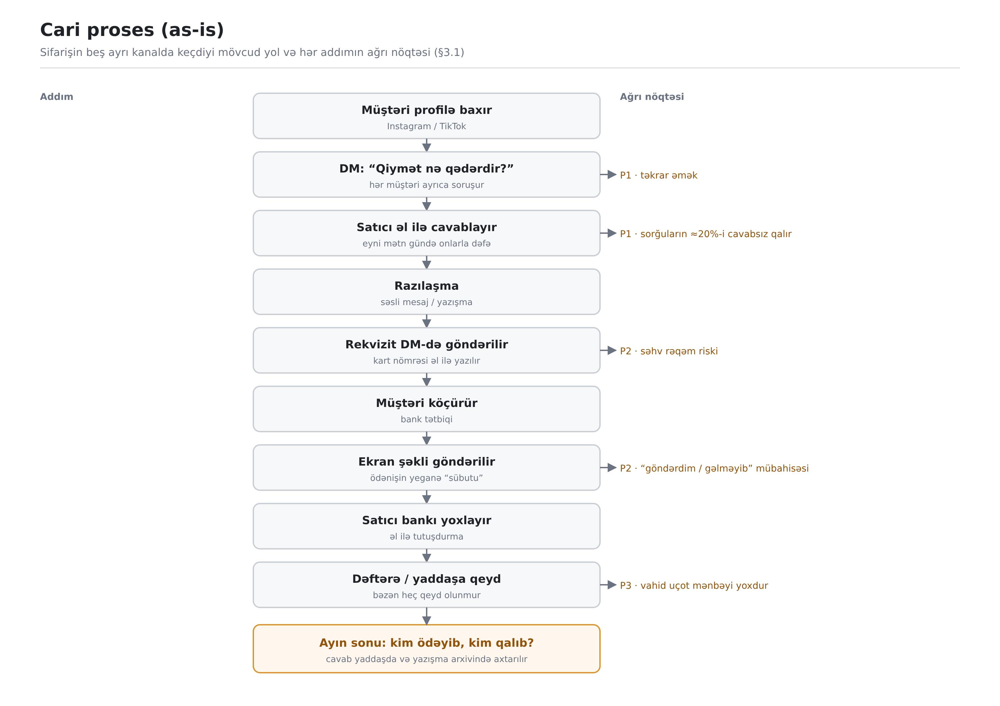

### 3.2 Cari vəziyyətin ağrı nöqtələri

| Addım | Ağrı | Problem |
|---|---|---|
| Qiymət sorğusu | Eyni cavabın gündə onlarla təkrarı | P1 |
| Rekvizit mübadiləsi | Səhv rəqəm, yanlış hesab | P2 |
| Ödəniş təsdiqi | "Göndərdim / gəlməyib" mübahisəsi | P2 |
| Uçot | Vahid mənbə yoxdur | P3 |
| Müştəri cəlbi | Yalnız mövcud izləyici | P4 |
| Sənəd | Nömrələnmiş hesab-faktura yoxdur | P2 |

### 3.3 Mövcud alternativlərin qiymətləndirilməsi

| Alternativ | Nə verir | Niyə kifayət etmir | Boşluq |
|---|---|---|---|
| Linktree / Taplink | Link siyahısı | Sifariş, faktura, ödəniş izləmə yoxdur | P1 qismən, P2/P3 tam açıq |
| Excel + WhatsApp | Əl ilə uçot | Nömrələnmiş sənəd, avtomatlaşdırma, analitika yoxdur | P2, P3 |
| Mühasibat proqramları | Rəsmi faktura | VÖEN-li şirkətlər üçündür; qiymət və mürəkkəblik fiziki şəxsə uyğun deyil | Qəbul edilməzlik |
| Instagram Shop | Məhsul kataloqu | Fiziki məhsul üçündür; "razılaşma ilə" qiymət dəstəklənmir | P1 qismən |
| Qlobal faktura SaaS (Wave, Zoho) | Faktura | Yerli bank rekvizitləri, dil, qiymət və sosial şəbəkə inteqrasiyası yoxdur | Yerli uyğunsuzluq |

## 4. Hədəf vəziyyət (to-be) və imkan boşluğu

### 4.1 Hədəf proses

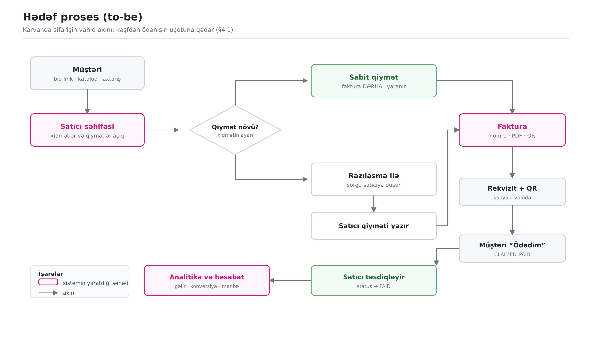

### 4.2 Tələb olunan biznes imkanları və boşluq təhlili

| # | Biznes imkanı | Cari vəziyyət | Hədəf vəziyyət | Boşluq | Aradan qaldıran |
|---|---|---|---|---|---|
| İ-01 | Xidmət və qiymətin ictimai təqdimatı | Yoxdur / statik profil | Strukturlaşdırılmış kataloq | Böyük | FR-SEH-*, FR-XID-* |
| İ-02 | Strukturlaşdırılmış sifariş qəbulu | DM yazışması | Forma + status | Böyük | FR-SIF-* |
| İ-03 | Nömrələnmiş hesab-faktura sənədi | Yoxdur | Avtomatik PDF, unikal nömrə | Böyük | FR-FAK-* |
| İ-04 | Ödənişin izlənməsi | Yaddaş / dəftər | Status maşını + təsdiq | Böyük | FR-ODN-* |
| İ-05 | Satış analitikası | Yoxdur | Dövr müqayisəli göstəricilər | Böyük | FR-ANL-* |
| İ-06 | Yeni müştəri kəşfi | Yalnız izləyici | Kataloq + axtarış trafiki | Böyük | FR-KAT-*, FR-SEO-* |
| İ-07 | Məzmun hazırlığı | Əl ilə | AI köməkçi | Orta | FR-AI-* |
| İ-08 | Monetizasiya və abunəlik | Yoxdur | Freemium + aqreqator | Böyük | FR-ABN-* |
| İ-09 | Əməliyyat nəzarəti və dəstək | Yoxdur | Admin panel, jurnal, moderasiya | Böyük | FR-ADM-* |
| İ-10 | Regional genişlənmə hazırlığı | Yoxdur | 4 dil, ölkə kodları, valyutalar | Orta | FR-DIL-* |
| İ-11 | Müştərinin onlayn kart ödənişi | Yoxdur | Faktura üzrə onlayn ödəniş | **Açıq** | v1.2 (§29) |
| İ-12 | Avtomatik bildiriş | Yoxdur | E-poçt / SMS / push | **Açıq** | v1.1 (§29) |

### 4.3 Təsirlənən biznes sahələri

| Sahə | Təsir | Keçid tədbiri |
|---|---|---|
| Satıcının gündəlik iş axını | DM-dən panelə keçid | TR-09 (onboarding), TR-10 (təlim materialı) |
| Müştəri təcrübəsi | Yazışmadan formaya | Dəyişiklik tələb olunmur (qeydiyyatsız axın) |
| Dəstək əməliyyatı | Yeni rol və alətlər | TR-08 (dəstək prosedurları) |
| Maliyyə uçotu | Abunəlik gəliri yaranır | TR-11 (mühasibat qaydası) |

---

## 5. Biznes əsaslandırması (business case)

### 5.1 Nəzərdən keçirilən variantlar

| # | Variant | Təsvir | CAPEX / OPEX | Problemi həll edir? |
|---|---|---|---|---|
| V1 | Status-kvo | Heç nə etməmək | 0 | Xeyr — P1-P4 qalır |
| V2 | Hazır həllərin birləşdirilməsi | Linktree + Wave + Google Sheets | Aşağı OPEX, yüksək əl əməyi | Qismən — P1 qismən, P3 yox |
| V3 | Hazır SaaS-ın lokallaşdırılması (ağ etiket) | Xarici platformanın yerli versiyası | Lisenziya + asılılıq | Qismən — yerli rekvizit və dil məhdud |
| V4 | **Öz platformanı qurmaq** | Karvan | Yüksək CAPEX (reallaşıb), aşağı OPEX | **Bəli** — P1-P4 |

### 5.2 Variantların qiymətləndirilməsi

Çəki cəmi 100; qiymət 1-5 (5 = ən yaxşı).

| Meyar | Çəki | V1 | V2 | V3 | V4 |
|---|---|---|---|---|---|
| Problemin həlli dərəcəsi | 30 | 1 | 2 | 3 | 5 |
| Yerli uyğunluq (dil, rekvizit, qiymət) | 20 | 1 | 2 | 2 | 5 |
| Monetizasiya imkanı | 20 | 1 | 1 | 3 | 5 |
| Reallaşma müddəti | 15 | 5 | 4 | 3 | 2 |
| Uzunmüddətli asılılıq riski | 15 | 5 | 3 | 1 | 4 |
| **Çəkili bal** | **100** | **2,05** | **2,25** | **2,55** | **4,40** |

### 5.3 Gözlənilən faydalar

| # | Fayda | Növü | Faydalanan | Ölçmə | Əlaqəli məqsəd |
|---|---|---|---|---|---|
| F1 | Təkrar yazışmaya sərf olunan vaxtın azalması | Kəmiyyət (dolayı) | Satıcı | Satıcı sorğusu, lansdan 60 gün sonra | BG-03 |
| F2 | Ödəniş mübahisələrinin azalması | Keyfiyyət | Satıcı, müştəri | Dəstək müraciətləri | BG-03 |
| F3 | Ödənilmə nisbətinin artması | Kəmiyyət | Satıcı | Analitika: PAID / SENT | BG-03 |
| F4 | Fakturadan ödənişə qədər vaxtın qısalması | Kəmiyyət | Satıcı | Analitika: orta saat | BG-04 |
| F5 | Kataloqdan yeni müştəri axını | Kəmiyyət | Satıcı, platforma | Mənbə analitikası | BG-06 |
| F6 | Abunəlik gəliri | Maliyyə | Platforma | MRR | BG-05 |
| F7 | Peşəkar görünüş və brend qavrayışı | Keyfiyyət | Satıcı | Keyfiyyət müsahibəsi | BG-02 |

### 5.4 Vahid iqtisadiyyat (model)

| Komponent | Dəyər | Fərziyyə |
|---|---|---|
| Ödəyənlərin bölgüsü | 60% Pro · 40% Pro Max | F-04 |
| İllik ödəyənlərin payı | 20% (2 ay endirim) | F-05 |
| **Blended ARPPU** | **≈ 17,4 AZN / ay** | Hesablama: (0,6×9,99 + 0,4×29,99) × (1 − 0,2×0,167) |
| Aqreqator komissiyası | ≈ 0,65 AZN | F-06 (2,5% + sabit) |
| AI istifadə xərci | ≈ 0,30 AZN | F-07 |
| Hostinq / saxlama (dəyişən hissə) | ≈ 0,35 AZN | F-08 |
| **Dəyişən xərc cəmi** | **≈ 1,30 AZN** | |
| **Ümumi marja** | **≈ 92%** | |
| Aylıq sabit xərc (hostinq, domen, e-poçt, AI baza) | ≈ 120 AZN | F-09 |

### 5.5 Zərərsizlik və geri qaytarma

| Göstərici | Dəyər |
|---|---|
| Marjinal gəlir (ödəyən başına) | ≈ 16,1 AZN |
| Zərərsizlik nöqtəsi | ≈ **8 ödəyən satıcı** |
| Fərz edilən aylıq saxlanma | 80% (BG-07) → orta ömür ≈ 5 ay |
| LTV | ≈ 80 AZN |
| Hədəf CAC | ≤ 12 AZN |
| LTV / CAC | ≈ 6,7 (sağlam hədd ≥ 3) |
| CAC geri qaytarma müddəti | < 1 ay |

### 5.6 12 aylıq gəlir proqnozu (model)

| Ay | Satıcı (kumulyativ) | Ödəyən payı | Ödəyən | MRR (AZN) |
|---|---|---|---|---|
| 3 | 500 | 5% | 25 | ≈ 435 |
| 6 | 1 000 | 6% | 60 | ≈ 1 044 |
| 9 | 1 500 | 7% | 105 | ≈ 1 827 |
| 12 | 2 000 | 8% | 160 | ≈ 2 784 |

### 5.7 Həlledici uğur amilləri

| # | Amil | Ölçmə | Risk əlaqəsi |
|---|---|---|---|
| U1 | Aktivləşmə (ilk fakturaya qədər) | BG-02 | RSK-04 |
| U2 | Ödəniş aqreqatorunun işləkliyi | BG-05 | RSK-01 |
| U3 | Kataloqun axtarışda görünməsi | BG-06 | RSK-09 |
| U4 | AI nəticələrinin keyfiyyəti | Satıcı rəyi | RSK-02 |
| U5 | Dəstək reaksiyasının sürəti | Dəstək SLA (§19) | RSK-10 |

---

## 6. Biznes məqsədləri və uğur metrikləri

### 6.1 Məqsədlər

| # | Məqsəd | Metrik | Baza | Hədəf | Müddət | Ölçmə yeri | Məsul |
|---|---|---|---|---|---|---|---|
| BG-01 | Satıcı bazası yaratmaq | Qeydiyyatdan keçən satıcı | 0 | ≥ 500 | Lans + 3 ay | Admin → İcmal | Marketinq |
| BG-02 | Aktivləşməni təmin etmək | Ən azı 1 faktura göndərən satıcının payı | — | ≥ 40% | Lans + 3 ay | Admin → İcmal | Məhsul |
| BG-03 | Satıcıya real dəyər vermək | Fakturaların ödənilmə nisbəti | — | ≥ 70% | Lans + 3 ay | Satıcı → Analitika (aqreqat) | Məhsul |
| BG-04 | Ödəniş dövrünü qısaltmaq | Fakturadan ödənişə orta vaxt | — | < 24 saat | Lans + 3 ay | Satıcı → Analitika | Məhsul |
| BG-05 | Monetizasiyanı sübut etmək | Pulsuzdan ödənişli plana keçid | 0 | ≥ 5% | Lans + 3 ay | Admin → Ödənişlər | Biznes |
| BG-06 | Orqanik böyümə kanalı qurmaq | Kataloqdan gələn sifarişlərin payı | 0 | ≥ 15% | Lans + 6 ay | Satıcı → Analitika (mənbələr) | Marketinq |
| BG-07 | Saxlanmanı təmin etmək | 2-ci ay abunəliyi uzadan | — | ≥ 80% | Lans + 4 ay | Admin → Ödənişlər | Biznes |

### 6.2 Metriklərin ölçmə planı

| Metrik | Mənbə | Tezlik | Hesablama | Məhdudiyyət |
|---|---|---|---|---|
| Qeydiyyat | `User` | Günlük | Say | — |
| Aktivləşmə | `Invoice` statusu ≠ DRAFT | Həftəlik | Unikal satıcı / ümumi satıcı | Demo hesablar çıxarılmalıdır (TR-05) |
| Ödənilmə nisbəti | `Invoice` | Həftəlik | PAID / (SENT+VIEWED+CLAIMED_PAID+PAID+OVERDUE) | CANCELLED daxil deyil |
| Ödəniş müddəti | `Invoice.sentAt`, `Payment.paidAt` | Həftəlik | Median və orta | Manual təsdiq gecikməsi daxildir |
| Plana keçid | `SubscriptionPayment` | Aylıq | Ödəyən / ümumi satıcı | Test ödənişləri çıxarılmalıdır |
| Kataloq payı | `ProfileEvent.source` | Aylıq | source=catalog / ümumi sifariş | Mənbə `?s=` etiketindən asılıdır |
| Saxlanma | `SubscriptionPayment` | Aylıq | 2-ci ay ödəyən / 1-ci ay ödəyən | Abunəlik avtomatik yenilənmir (§30.1) |

### 6.3 Əks-metriklər

| # | Əks-metrik | Hədd | Niyə |
|---|---|---|---|
| G-01 | Moderasiyada bloklanan xidmətlərin payı | ≤ 3% | Kataloqun keyfiyyəti (RSK-03) |
| G-02 | Dəstəyə düşən "ödəniş görünmür" müraciəti | ≤ 2% ödənişdən | Ödəniş axınının aydınlığı |
| G-03 | AI nəticəsinin satıcı tərəfindən düzəldilmə payı | ≤ 40% | AI keyfiyyəti (RSK-02) |
| G-04 | Hesab silmə tələbi | ≤ 2% / ay | Məhsul uyğunluğu |

---

## 7. Həllin əhatə dairəsi

### 7.1 Kontekst diaqramı

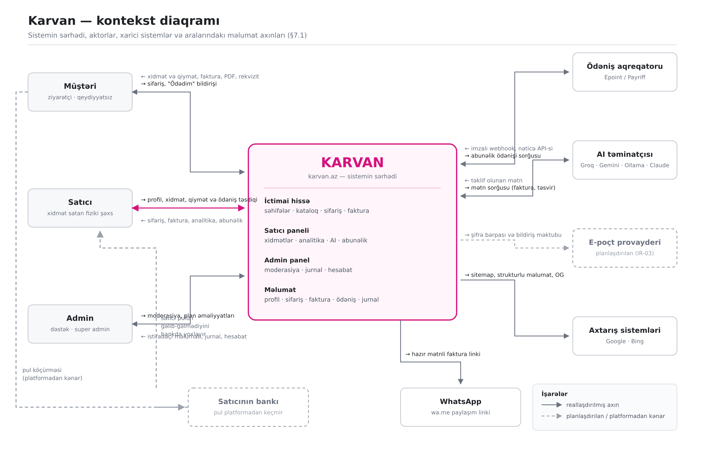

Diaqram sistemin sərhədini və onu kəsən bütün axınları göstərir. Oxunuşu:

| Tərəf | Kim / nə | Karvana verir | Karvandan alır |
|---|---|---|---|
| Aktor | **Müştəri** (qeydiyyatsız) | Sifariş, "Ödədim" bildirişi | Xidmət və qiymət, faktura, PDF, rekvizit |
| Aktor | **Satıcı** | Profil, xidmət, qiymət və ödəniş təsdiqi | Sifariş, faktura, analitika, abunəlik |
| Aktor | **Admin / super admin** | Moderasiya, plan və hesab əməliyyatları | İstifadəçi məlumatı, jurnal, hesabat |
| Xarici sistem | **Ödəniş aqreqatoru** (Epoint / Payriff) | İmzalı webhook, nəticə API-si | Abunəlik ödənişi sorğusu |
| Xarici sistem | **AI təminatçısı** | Təklif olunan mətn | Mətn sorğusu (faktura, təsvir, xatırlatma) |
| Xarici sistem | **E-poçt provayderi** ⬜ | — | Şifrə bərpası və bildiriş məktubu |
| Xarici sistem | **Axtarış sistemləri** | — | Sitemap, strukturlu məlumat, OG şəkilləri |
| Xarici kanal | **WhatsApp** | — | Hazır mətnli faktura linki |
| **Sərhəddən kənar** | **Satıcının bankı** | — | — |

Diaqramın ən vacib detalı sağ-aşağı küncdədir: **pul axını sistemin sərhədindən keçmir**. Müştəri köçürməni birbaşa satıcının bankına edir, satıcı da ödənişi orada yoxlayır; Karvan yalnız bu faktın qeydini (status və sənəd) saxlayır. Bu bölgü platformanın hüquqi mövqeyini müəyyən edir (BRU-16, §23.1) və eyni zamanda ödəniş təsdiqinin niyə manual qaldığını izah edir (M-06).

Kəsik xətlər iki şeyi bildirir: hələ reallaşdırılmamış axını (e-poçt provayderi — IR-03) və platformadan kənar baş verən əməliyyatı (bank köçürməsi).

### 7.2 Əhatəyə daxildir

| # | Sahə | Təsvir | Tələb qrupu |
|---|---|---|---|
| E-01 | Hesab və autentifikasiya | Qeydiyyat, giriş, şifrə, sessiya | FR-HES |
| E-02 | Satıcı səhifəsi | Link-in-bio, profil, portfolio, sosial linklər | FR-SEH |
| E-03 | Xidmətlər | Kataloq idarəetməsi, qiymət növləri, moderasiya | FR-XID |
| E-04 | Xidmətlər kataloqu | Ümumi axtarış və filtrlər | FR-KAT |
| E-05 | Sifariş | Forma, sorğu, təsdiq axını | FR-SIF |
| E-06 | Faktura və PDF | Nömrələmə, sənəd, ictimai səhifə | FR-FAK |
| E-07 | Ödəniş izləmə | Manual təsdiq, status maşını | FR-ODN |
| E-08 | Analitika | Satış və auditoriya göstəriciləri | FR-ANL |
| E-09 | AI köməkçi | 4 funksiya, çox təminatçı | FR-AI |
| E-10 | Abunəlik və monetizasiya | Planlar, ödəniş, aktivləşmə | FR-ABN |
| E-11 | Admin panel | İstifadəçi əməliyyatları, moderasiya, jurnal, ixrac | FR-ADM |
| E-12 | Çoxdillilik və görünüş | 4 dil, qaranlıq rejim | FR-DIL |
| E-13 | SEO | Metadata, strukturlu məlumat, sitemap | FR-SEO |
| E-14 | Bildirişlər | WhatsApp linki ✅, avtomatik kanallar 🟡 | FR-BLD |

### 7.3 Əhatədən kənar

| # | Mövzu | Səbəb | Nə vaxt |
|---|---|---|---|
| X-01 | Müştəri fakturasının onlayn kart ödənişi | Hər satıcı üçün merchant modeli hüquqi qərar tələb edir (§31 S3) | v1.2 |
| X-02 | Avtomatik e-poçt / SMS / push bildirişləri | Provayder müqaviləsi yoxdur | v1.1 |
| X-03 | Komanda üzvləri (Pro Max-da elan olunub) | Rol modeli genişləndirilməlidir; interfeysdə "tezliklə" | v1.4 |
| X-04 | VÖEN və e-qaimə inteqrasiyası | Hazırkı modeldə hüquqi tələb yaranmır (§23.2) | v2 |
| ~~X-05~~ | ~~Rəy və reytinq sistemi~~ — reallaşıb | Yalnız ödənişi təsdiqlənmiş müştəri rəy yazır; admin moderasiyası var | ✅ |
| X-06 | Native mobil tətbiq | Veb tətbiq mobil-uyğundur, dəyər əsaslandırılmır | Qərar yoxdur |
| X-07 | Təqvim / rezervasiya | Ayrıca məhsul sahəsi | Qərar yoxdur |
| X-08 | Çoxvalyutalı konvertasiya və cəmləmə | Məzənnə mənbəyi və məsuliyyət müəyyən deyil (BRU-02) | v2 |
| X-09 | Abunəliyin avtomatik yenilənməsi | Kart tokenizasiyası aqreqatordan asılıdır | v2 |

### 7.4 Əhatə sərhədləri (boundary)

| Sərhəd | Karvanın məsuliyyəti | Kənarda |
|---|---|---|
| Pul axını | Faktura və statusun uçotu | Pulun özünün köçürülməsi (satıcı ↔ müştəri bankı) |
| Məzmun | Moderasiya və bloklama | Xidmətin keyfiyyəti və icrası |
| Müştəri məlumatı | Saxlama və qoruma | Satıcının bu məlumatı necə istifadə etməsi |
| Vergi | Sənədin "rəsmi deyil" qeydi | Satıcının vergi öhdəlikləri |

---

## 8. Paydaş təhlili

### 8.1 Paydaş reyestri

| # | Paydaş | Növü | Maraq | Təsir | Mövqe | Əlaqə strategiyası |
|---|---|---|---|---|---|---|
| PD-01 | Məhsul sahibi / sponsor | Daxili | Yüksək | Yüksək | Dəstəkləyən | İdarə et: həftəlik status, qərar nöqtələri |
| PD-02 | Satıcı (son istifadəçi) | Xarici | Yüksək | Orta | Neytral→Dəstəkləyən | Yaxından məlumatlandır: onboarding, dəstək, rəy kanalı |
| PD-03 | Müştəri (alıcı) | Xarici | Orta | Aşağı | Passiv | Qane et: qeydiyyatsız, sadə axın |
| PD-04 | Dəstək operatoru | Daxili | Orta | Orta | Dəstəkləyən | Təlim (TR-10), prosedurlar (TR-08) |
| PD-05 | Texniki komanda | Daxili | Yüksək | Yüksək | Dəstəkləyən | NFR və interfeys tələbləri üzrə razılaşma |
| PD-06 | Ödəniş aqreqatoru | Xarici | Orta | **Yüksək** | Neytral | Müqavilə, test mühiti, SLA (IR-01) |
| PD-07 | AI təminatçısı | Xarici | Aşağı | Orta | Neytral | Dəyişdirilə bilən saxlanılır (IR-02) |
| PD-08 | E-poçt / SMS provayderi | Xarici | Aşağı | Orta | Neytral | v1.1-də müqavilə (IR-03) |
| PD-09 | Hüquq məsləhətçisi | Xarici | Orta | Yüksək | Neytral | §23 üzrə rəy, lansdan əvvəl |
| PD-10 | Axtarış sistemləri | Xarici | Aşağı | Orta | Passiv | Texniki uyğunluq (FR-SEO) |
| PD-11 | Tənzimləyici (ödəniş/məlumat) | Xarici | Aşağı | **Yüksək** | Passiv | Modelin vasitəçilikdən kənarda saxlanması (§23.1) |

### 8.2 Güc / maraq matrisi

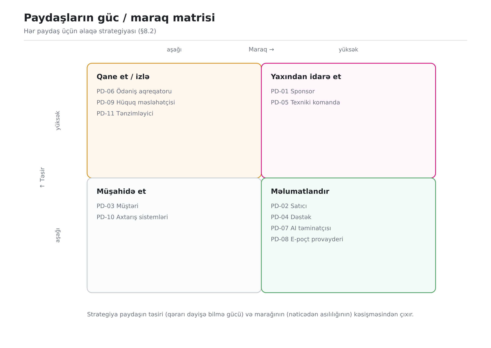

### 8.3 Sistem rolları və icazələr

| Rol | Kim | Əsas icazələr | Məhdudiyyət |
|---|---|---|---|
| **Ziyarətçi** | Qeydiyyatsız şəxs | Ana səhifə, kataloq, satıcı səhifəsi, sifariş vermək, faktura səhifəsini açmaq | Panelə çıxış yoxdur |
| **Satıcı** (`USER`) | Xidmət satan fiziki şəxs | Öz profili, xidmətlər, sifarişlər, fakturalar, analitika, abunəlik, parametrlər | Yalnız öz məlumatı (BRU-04) |
| **Menecer** (`MANAGER`) | Satıcının komanda üzvü | Sifarişlər, fakturalar, xidmətlər, səhifə, analitika, rəylər, bildirişlər, AI | Abunəlik, rekvizitlər, komanda və hesab parametrlərinə çıxışı yoxdur |
| **İşçi** (`STAFF`) | Satıcının komanda üzvü | Yalnız sifarişlər və fakturalar | Analitika, xidmətlər, səhifə, abunəlik, rekvizitlər bağlıdır |
| **Admin** (`ADMIN`) | Dəstək komandası | İstifadəçi axtarışı və düzəlişi, plan dəyişmək, bloklamaq, moderasiya, jurnal, ixrac, köçürmə təsdiqi | Admini bloklaya/silə bilməz (BRU-14) |
| **Super admin** (`SUPER_ADMIN`) | Məhsul sahibi | Admin icazələri + rol təyinatı, istifadəçi kimi daxil olmaq, AI ayarları | Sonuncu super admin rolunu itirə bilməz (BRU-14) |

### 8.4 RACI matrisi

`R` icraçı · `A` cavabdeh · `C` məsləhətləşilir · `I` məlumatlandırılır

| Fəaliyyət | Sponsor | BA | Texniki | Dəstək | Satıcı | Hüquq |
|---|---|---|---|---|---|---|
| Əhatənin təsdiqi | **A** | R | C | I | C | I |
| Tələblərin toplanması və baseline | C | **A/R** | C | C | C | C |
| Həllin reallaşdırılması | I | C | **A/R** | I | — | — |
| NFR-lərin qəbulu | I | C | **A/R** | I | — | — |
| UAT-ın aparılması | A | **R** | C | R | C | — |
| Moderasiya qaydaları | A | R | I | **R** | I | C |
| Abunəlik qiymətləri | **A/R** | C | I | I | I | C |
| Hüquqi sənədlər | A | C | I | I | I | **R** |
| Buraxılış qərarı (go/no-go) | **A** | R | R | C | I | C |
| Lansdan sonrakı qiymətləndirmə | A | **R** | C | C | C | I |

### 8.5 Kommunikasiya planı

| Nə | Kimə | Tezlik | Kanal | Məsul |
|---|---|---|---|---|
| Tələblərin statusu | Sponsor, texniki | Həftəlik | Status icmalı | BA |
| Dəyişiklik sorğuları | Sponsor | Yarandıqca | CR forması (§28) | BA |
| Buraxılış şərtlərinin vəziyyəti | Bütün daxili | Həftəlik (lansa 4 həftə qalmış) | §26 cədvəli | BA |
| Satıcı rəyi | Məhsul, BA | Davamlı | Dəstək kanalı | Dəstək |
| Metriklərin icmalı | Sponsor | Aylıq | §27 hesabatı | BA |

---

## 9. Personalar və istifadəçi profilləri

| # | Persona | Profil | Əsas ehtiyac | İşlətdiyi tələblər | Uğur meyarı |
|---|---|---|---|---|---|
| PR-01 | **Leyla, makiyaj ustası** | Bakı, 2,4K izləyici, gündə 3-5 DM | Qiymətin açıq görünməsi; gəlin makiyajı üçün razılaşma qiyməti | FR-SEH, FR-XID, FR-SIF-04 | Səhifəni 3 dəqiqəyə qurur, ilk sifarişi həmin gün alır |
| PR-02 | **Aygün, repetitor** | Onlayn dərs, aylıq paket satışı | Paketlər üçün faktura, kimin ödədiyini izləmək | FR-FAK, FR-ODN, FR-ANL | Ayın sonunda qalan borcları 1 ekranda görür |
| PR-03 | **Pixel Lab, dizayn studiyası** | 3 nəfər, USD ilə iş | Peşəkar sənəd, valyuta seçimi, öz brendi | FR-XID-01, FR-FAK-05, FR-ABN | Platforma yazısı olmadan öz brendi ilə faktura göndərir |
| PR-04 | **Nərmin, müştəri** | Instagram-dan gəlir | Qiyməti görmək, tez sifariş, aydın rekvizit | FR-SIF-01, FR-FAK-03, FR-ODN-01 | 2 kliklə sifariş verir, fakturanı telefonunda açır |
| PR-05 | **Dəstək operatoru** | Karvan komandası | Şikayəti tez həll etmək | FR-ADM | İstifadəçini tapır, jurnaldan səbəbi görür, şifrəni sıfırlayır |

### 9.1 İstifadəçi mühiti və əlçatanlıq fərziyyələri

| Parametr | Fərziyyə | Tələbə təsiri |
|---|---|---|
| Əsas cihaz | Mobil telefon (≥ 80% trafik) | NFR-USE-01 (mobil-öncə) |
| Bağlantı | 3G/4G, qeyri-sabit | NFR-PER-01, PDF ölçüsü |
| Texniki hazırlıq | Aşağı–orta | FR-HES-01 (2 addımlı qeydiyyat), onboarding (TR-09) |
| Dil | Azərbaycan (əsas), rus (ikinci) | FR-DIL |
| Əlçatanlıq ehtiyacı | Klaviatura, ekran oxuyucu, hərəkət həssaslığı | NFR-ACC-01…03 |

---

## 10. Tələblərin arxitekturası

### 10.1 Tələb səviyyələri və əlaqəsi

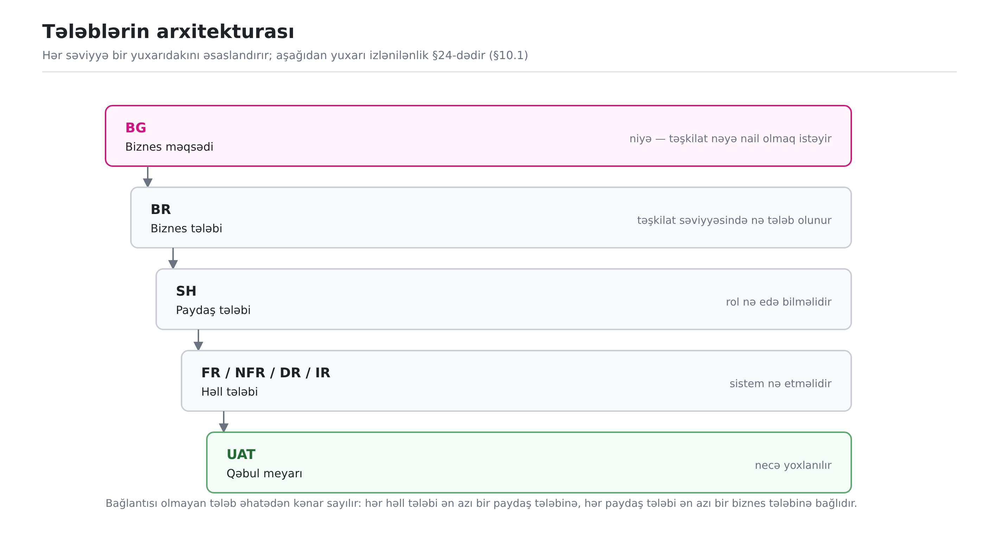

Tam izlənilənlik §24-dədir. Hər həll tələbi ən azı bir paydaş tələbinə, hər paydaş tələbi ən azı bir biznes tələbinə bağlıdır; bağlantısız tələb əhatədən kənar sayılır.

### 10.2 Tələbin atributları

Hər həll tələbi cədvəlində aşağıdakı atributlar saxlanılır:

| Atribut | İzah |
|---|---|
| ID | Unikal identifikator (§0.5) |
| Tələb | "Sistem … olmalıdır" formasında ifadə |
| Pri | MoSCoW prioriteti |
| Mənbə | Tələbi doğuran paydaş / sənəd |
| Yox. | Yoxlama üsulu (T/D/İ/A) |
| Vəz. | Reallaşma vəziyyəti (✅/🟡/⬜) |

### 10.3 Tələblərin keyfiyyət meyarları

Baseline-a daxil olan hər tələb yoxlanılıb: **atomik** (bir tələb — bir fikir), **birmənalı**, **yoxlanıla bilən**, **reallaşdırıla bilən**, **izlənilən** və **ziddiyyətsiz**. Bu meyarlara cavab verməyən ifadələr fərziyyə (§21.1) və ya açıq sual (§31) kimi qeyd olunub.

---

## 11. Biznes tələbləri (BR)

Təşkilat səviyyəsində, həlldən asılı olmayan tələblər.

| # | Biznes tələbi | Əsaslandırma | Məqsəd | Pri |
|---|---|---|---|---|
| BR-01 | Satıcı öz xidmətlərini və qiymətlərini müştəriyə ictimai, strukturlaşdırılmış formada təqdim edə bilməlidir | P1 | BG-01, BG-02 | M |
| BR-02 | Sifariş qəbulu yazışmadan asılı olmayan, izlənilə bilən prosesə çevrilməlidir | P1, P3 | BG-02, BG-03 | M |
| BR-03 | Hər ödəniş tələbi unikal nömrəli, bərpa oluna bilən sənədlə təsdiqlənməlidir | P2 | BG-03 | M |
| BR-04 | Ödənişin vəziyyəti istənilən anda birmənalı müəyyən olunmalıdır | P2, P3 | BG-03, BG-04 | M |
| BR-05 | Satıcı satışının vəziyyətini ölçülə bilən göstəricilərlə görə bilməlidir | P3 | BG-03, BG-04 | M |
| BR-06 | Platforma satıcıya mövcud izləyicisindən kənar müştəri axını yaratmalıdır | P4 | BG-06 | S |
| BR-07 | Platforma özünü abunəlik gəliri ilə maliyyələşdirməlidir | Davamlılıq | BG-05, BG-07 | M |
| BR-08 | Pul platformada toplanmamalı, bu da vasitəçilik lisenziyası tələbini yaratmamalıdır | Hüquqi | §23.1 | M |
| BR-09 | Platforma məzmuna nəzarət və sui-istifadəyə qarşı əməliyyat aləti təmin etməlidir | Etibar | G-01 | M |
| BR-10 | Hər əməliyyat sonradan araşdırıla bilən formada qeydə alınmalıdır | Hesabatlılıq | G-02 | M |
| BR-11 | Həll regional genişlənməyə (dil, ölkə kodu, valyuta) texniki baxımdan hazır olmalıdır | Böyümə | Strategiya | S |
| BR-12 | İstifadəçinin şəxsi məlumatı minimum həcmdə toplanmalı və qorunmalıdır | Hüquqi, etibar | §23.3 | M |

---

## 12. Paydaş tələbləri (SH)

### 12.1 Satıcı (`SH-SAT`)

| # | Tələb | Mənbə | Bağlı BR |
|---|---|---|---|
| SH-SAT-01 | Mən hesabımı telefonla, uzun formadan keçmədən 5 dəqiqəyə yarada bilməliyəm | PR-01 | BR-01 |
| SH-SAT-02 | Mən bir linkdə bütün xidmətlərimi, qiymətlərimi və əlaqəmi göstərə bilməliyəm | PR-01 | BR-01 |
| SH-SAT-03 | Mən qiyməti əvvəlcədən deyilə bilməyən işlər üçün sorğu qəbul edə bilməliyəm | PR-01 | BR-02 |
| SH-SAT-04 | Mən sifariş gələndə faktura hazırlamaq üçün əlavə iş görməməliyəm | PR-02 | BR-03 |
| SH-SAT-05 | Mən müştəriyə rekvizitlərimi səhvsiz, kopyalana bilən formada çatdırmalıyam | PR-02 | BR-03 |
| SH-SAT-06 | Mən kimin ödədiyini, kimin gecikdiyini bir ekranda görməliyəm | PR-02 | BR-04 |
| SH-SAT-07 | Mən gəlirimi, konversiyamı və müştəri mənbələrimi ölçə bilməliyəm | PR-02 | BR-05 |
| SH-SAT-08 | Mən öz brendimi (rəng, loqo, platforma yazısının olmaması) qoruya bilməliyəm | PR-03 | BR-07 |
| SH-SAT-09 | Mən valyuta ilə işləyə bilməliyəm | PR-03 | BR-11 |
| SH-SAT-10 | Mən mətn hazırlamağa vaxt sərf etməməliyəm | PR-01, PR-03 | BR-01 |
| SH-SAT-11 | Mən yeni müştərinin məni kataloqdan tapmasını istəyirəm, lakin bunu söndürə də bilməliyəm | PR-01 | BR-06, BR-12 |
| SH-SAT-12 | Mən planımı özüm seçib, ödənişi özüm idarə etməliyəm | PR-03 | BR-07 |
| SH-SAT-13 | Mən hesabımı və məlumatlarımı silə bilməliyəm | PR-01 | BR-12 |
| SH-SAT-14 | Mən işimi tək idarə etməyəndə komanda yoldaşımı panelə əlavə edə, ona nə görə biləcəyini özüm təyin edə bilməliyəm | PR-03 | BR-07 |

### 12.2 Müştəri (`SH-MUS`)

| # | Tələb | Mənbə | Bağlı BR |
|---|---|---|---|
| SH-MUS-01 | Mən qeydiyyatdan keçmədən sifariş verə bilməliyəm | PR-04 | BR-02 |
| SH-MUS-02 | Mən qiyməti sifarişdən əvvəl görməliyəm | PR-04 | BR-01 |
| SH-MUS-03 | Mən fakturanı telefonumda açıb rekvizitləri bir toxunuşla kopyalamalıyam | PR-04 | BR-03 |
| SH-MUS-04 | Mən ödədiyimi bildirə və bunun qeydə alındığını görməliyəm | PR-04 | BR-04 |
| SH-MUS-05 | Mənim şəxsi məlumatım yalnız sifariş verdiyim satıcıya görünməlidir | PR-04 | BR-12 |

### 12.3 Admin və dəstək (`SH-ADM`)

| # | Tələb | Mənbə | Bağlı BR |
|---|---|---|---|
| SH-ADM-01 | Mən istifadəçini ad, e-poçt, telefon və ya səhifə ünvanı ilə saniyələr içində tapmalıyam | PR-05 | BR-09 |
| SH-ADM-02 | Mən şikayətin səbəbini istifadəçinin fəaliyyət tarixçəsindən görməliyəm | PR-05 | BR-10 |
| SH-ADM-03 | Mən qaydalara zidd xidməti və ya hesabı dərhal bağlaya bilməliyəm | PR-05 | BR-09 |
| SH-ADM-04 | Mən istifadəçinin tarifini dəyişə və köçürmə ödənişini təsdiqləyə bilməliyəm | PR-05 | BR-07 |
| SH-ADM-05 | Mən şifrəni görmədən sıfırlaya bilməliyəm | PR-05 | BR-12 |
| SH-ADM-06 | Mənim hər əməliyyatım qeydə alınmalı və geri silinməməlidir | PR-05 | BR-10 |
| SH-ADM-07 | Mən istifadəçi və jurnal siyahısını xarici təhlil üçün ixrac edə bilməliyəm | PR-05 | BR-10 |

### 12.4 Biznes sahibi (`SH-BIZ`)

| # | Tələb | Mənbə | Bağlı BR |
|---|---|---|---|
| SH-BIZ-01 | Mən platformanın istifadəçi və gəlir göstəricilərini bir ekranda görməliyəm | PD-01 | BR-07 |
| SH-BIZ-02 | Mən plan strukturunu və limitləri biznes qərarına uyğun dəyişə bilməliyəm | PD-01 | BR-07 |
| SH-BIZ-03 | Mən platformanın hüquqi riskini artıran axınlara icazə verməməliyəm | PD-09 | BR-08 |
| SH-BIZ-04 | Mən xarici təminatçıdan asılılığı dəyişdirilə bilən saxlamalıyam | PD-01 | BR-11 |

---

## 13. Funksional həll tələbləri (FR)

### 13.1 Hesab və autentifikasiya — `FR-HES`

| # | Tələb | Pri | Mənbə | Yox. | Vəz. |
|---|---|---|---|---|---|
| FR-HES-01 | Qeydiyyat iki addımdan ibarət olmalıdır: ① ad, soyad, brend (könüllü), telefon, vətəndaşlıq, FİN/pasport ② səhifə ünvanı, e-poçt, şifrə | M | SH-SAT-01 | T | ✅ |
| FR-HES-02 | Səhifə ünvanı (`username`) unikal olmalı, 3-30 simvol və yalnız `a-z 0-9 _ .` qəbul etməli, sistem yollarını təkrarlayan adlar qadağan edilməlidir | M | SH-SAT-02 | T | ✅ |
| FR-HES-03 | Telefon nömrəsi ölkə kodu ilə seçilməli (+994, +90, +995, +7, +998, +380, +49, +1), ölkəyə uyğun maskalanmalı, tam nömrə yapışdırılanda kod avtomatik tanınmalıdır | M | SH-SAT-01, BR-11 | T | ✅ |
| FR-HES-04 | Azərbaycan vətəndaşı 7 simvollu FİN, xarici vətəndaş 5-20 simvollu pasport nömrəsi daxil etməlidir; bu məlumat yalnız hesabın təsdiqi üçün saxlanılmalı və ictimai səhifədə göstərilməməlidir | M | BR-12 | İ | ✅ |
| FR-HES-05 | Giriş e-poçt və şifrə ilə aparılmalı, sessiya müddəti 30 gün olmalıdır | M | SH-SAT-01 | T | ✅ |
| FR-HES-06 | Şifrə bərpası e-poçta göndərilən link ilə aparılmalı (30 dəqiqə etibarlı, saatda ən çox 3 sorğu); bərpa bütün aktiv sessiyaları bağlamalıdır | M | SH-SAT-01 | T | 🟡 E-poçt provayderi qoşulmayıb — IR-03 |
| FR-HES-07 | Satıcı e-poçtunu və şifrəsini dəyişə, digər cihazlardan çıxa və hesabını silə bilməlidir (ad təsdiqi + şifrə) | M | SH-SAT-13 | T | ✅ |
| FR-HES-08 | Ana səhifədə ödənişli paket seçilibsə, qeydiyyat və ya girişdən sonra istifadəçi birbaşa həmin paketin ödəniş səhifəsinə yönləndirilməlidir | S | SH-SAT-12 | T | ✅ |
| FR-HES-09 | Bloklanmış hesab daxil ola bilməməli, giriş cəhdində səbəb göstərilməlidir | M | SH-ADM-03 | T | ✅ |
| FR-HES-10 | Qeydiyyat yalnız istifadə şərtləri və məxfilik siyasəti qəbul edildikdə tamamlanmalı; qəbulun anı və sənəd versiyası saxlanılmalıdır | M | §23, TR-07 | T | ✅ |
| FR-HES-11 | İstifadəçi uzun müddət girişi olmayan hesabın avtomatik silinməsini idarə edə bilməlidir (defolt 90 gün; silinmədən 14 gün əvvəl xəbərdarlıq) | S | SH-SAT-13, BR-12 | T | ✅ |

### 13.2 Satıcı səhifəsi (link-in-bio) — `FR-SEH`

| # | Tələb | Pri | Mənbə | Yox. | Vəz. |
|---|---|---|---|---|---|
| FR-SEH-01 | Səhifə `karvan.az/<username>` ünvanında açılmalı, mobil-uyğun olmalı və satıcının seçdiyi brend rəngini tətbiq etməlidir | M | SH-SAT-02, SH-SAT-08 | D | ✅ |
| FR-SEH-02 | Profil elementləri: ad/brend, peşə, şəhər, qısa bio, profil şəkli/loqo, üz qabığı şəkli | M | SH-SAT-02 | D | ✅ |
| FR-SEH-03 | Sosial hesablar dəstəklənməlidir: Instagram, TikTok, WhatsApp, Telegram, YouTube, Facebook, LinkedIn, Behance, Dribbble, X, Threads, Pinterest, e-poçt, veb sayt və sərbəst linklər | S | SH-SAT-02 | D | ✅ |
| FR-SEH-04 | "Haqqımda" mətni (≤ 3000 simvol) və "Gördüyüm işlər" portfoliosu (şəkil, ad, təsvir, link) dəstəklənməlidir | S | SH-SAT-02 | D | ✅ |
| FR-SEH-05 | Əlaqə nömrəsi "Zəng et" düyməsi kimi göstərilməli və toxunuşla zəng başlatmalıdır | M | SH-MUS-01 | T | ✅ |
| FR-SEH-06 | Xidmət kartı: ad, şəkil (könüllü), qiymət və ya "Razılaşma ilə", müddət, təsvir, "Sifariş et" düyməsi | M | SH-MUS-02 | D | ✅ |
| FR-SEH-07 | Səhifədə ana səhifəyə qayıdış düyməsi və kataloqa aparan naviqasiya zənciri olmalıdır | S | SH-MUS-01 | D | ✅ |
| FR-SEH-08 | Pulsuz planda səhifənin altında platforma qeydi göstərilməli, ödənişli planlarda göstərilməməlidir | M | SH-SAT-08, BR-07 | T | ✅ |
| FR-SEH-09 | Pro və Pro Max hesablarda adın yanında təsdiqlənmiş nişanı göstərilməlidir | S | SH-SAT-08 | D | ✅ |
| FR-SEH-10 | Bloklanmış hesabın səhifəsi 404 qaytarmalı, bloklanmış xidmət səhifədə görünməməlidir | M | SH-ADM-03 | T | ✅ |
| FR-SEH-11 | Satıcı səhifəsinin interfeysi çoxdilli olmalıdır | C | SH-SAT-09, BR-11 | T | ✅ 4 dil; ziyarətçi səhifədəki seçicidən dili dəyişir, satıcının mətnləri olduğu kimi qalır |

### 13.3 Xidmətlər — `FR-XID`

| # | Tələb | Pri | Mənbə | Yox. | Vəz. |
|---|---|---|---|---|---|
| FR-XID-01 | Xidmət atributları: ad, təsvir, sahə (12 kateqoriya), qiymət növü (sabit / razılaşma ilə), məbləğ, valyuta (AZN, USD, EUR), müddət (gün/həftə/ay), şəkil, sıra, aktivlik | M | SH-SAT-02, SH-SAT-09 | D | ✅ |
| FR-XID-02 | Sahə "Digər" seçildikdə satıcı növü sərbəst mətnlə yazmalı, bu mətn kataloq axtarışında nəzərə alınmalıdır | S | SH-SAT-02 | T | ✅ |
| FR-XID-03 | Məbləğlər qəpik/sent dəqiqliyində tam ədəd kimi saxlanılmalı, fərqli valyutalar qarışdırılmamalıdır | M | BRU-02 | İ | ✅ |
| FR-XID-04 | Sistem xidmət təsvirinin 3 variantını AI ilə təklif etməlidir | C | SH-SAT-10 | D | ✅ |
| FR-XID-05 | Xidmətlərin sayı plan limiti ilə məhdudlaşmalıdır (5 / 30 / limitsiz) | M | BR-07 | T | ✅ |
| FR-XID-06 | Panelin xidmətlər siyahısında axtarış və filtrlər (sahə, qiymət növü, status) olmalıdır | S | SH-SAT-02 | D | ✅ |

### 13.4 Xidmətlər kataloqu — `FR-KAT`

| # | Tələb | Pri | Mənbə | Yox. | Vəz. |
|---|---|---|---|---|---|
| FR-KAT-01 | Kataloq dörd dildə ayrıca ünvanda açılmalıdır: `/xidmetler`, `/tr/hizmetler`, `/ru/uslugi`, `/en/services` | M | BR-06, BR-11 | T | ✅ |
| FR-KAT-02 | Aktiv xidməti olan hər satıcı kataloqda avtomatik görünməlidir | M | BR-06 | T | ✅ |
| FR-KAT-03 | Satıcı parametrlərdən kataloqda görünməməyi seçə bilməlidir | M | SH-SAT-11 | T | ✅ |
| FR-KAT-04 | Filtrlər: açar söz, sahə, şəhər, qiymət növü, valyuta, min/maks məbləğ, yalnız təsdiqlənmiş, sıralama (tövsiyə, yeni, ucuzdan, bahadan) | S | SH-MUS-02 | D | ✅ |
| FR-KAT-05 | Səhifədə 24 nəticə göstərilməli və səhifələmə olmalıdır | S | NFR-PER-01 | T | ✅ |
| FR-KAT-06 | "Tövsiyə olunan" sıralamada Pro Max hesablar önə çıxmalı və müvafiq nişan almalıdır | S | BR-07 | T | ✅ |
| FR-KAT-07 | Sahə və şəhər üçün klik edilə bilən, indeksləşən linklər olmalıdır | S | BR-06 | İ | ✅ |
| FR-KAT-08 | Kartdan satıcının səhifəsinə keçid olmalı, sifariş orada verilməlidir | M | BR-02 | T | ✅ |
| FR-KAT-09 | Kataloqda rəy və reytinq sistemi olmalıdır | S | SH-MUS-02 | T | ✅ Kartda reytinq göstərilir, "Reytinqə görə" sıralaması var |

### 13.5 Sifariş — `FR-SIF`

| # | Tələb | Pri | Mənbə | Yox. | Vəz. |
|---|---|---|---|---|---|
| FR-SIF-01 | Sifariş forması qeydiyyat tələb etməməli və ad, telefon (məcburi), e-poçt (könüllü), qeyd sahələrini əhatə etməlidir | M | SH-MUS-01 | T | ✅ |
| FR-SIF-02 | Forma X düyməsi, "Ləğv et" və Esc klavişi ilə bağlanmalıdır | S | SH-MUS-01 | T | ✅ |
| FR-SIF-03 | Sabit qiymətli xidmətdə faktura dərhal yaranmalı və müştəri faktura səhifəsinə yönləndirilməlidir | M | SH-SAT-04 | T | ✅ |
| FR-SIF-04 | "Razılaşma ilə" xidmətdə sorğu `PENDING_APPROVAL` statusu ilə satıcıya düşməlidir | M | SH-SAT-03 | T | ✅ |
| FR-SIF-05 | Satıcı sorğunu qiymət yazaraq təsdiqləməli (faktura yaranır) və ya imtina etməlidir | M | SH-SAT-03 | T | ✅ |
| FR-SIF-06 | Satıcının aylıq faktura limiti dolubsa, sabit qiymətli sifariş itməməli, sorğuya çevrilməlidir | M | BR-02, BR-07 | T | ✅ |
| FR-SIF-07 | Sifarişin gəldiyi mənbə (Instagram, TikTok, kataloq, axtarış, birbaşa və s.) qeyd olunmalıdır | S | SH-SAT-07 | T | ✅ |
| FR-SIF-08 | Panelin sifarişlər siyahısında axtarış, status, xidmət və tarix filtrləri olmalıdır | S | SH-SAT-06 | D | ✅ |
| FR-SIF-09 | Yeni sifariş barədə satıcıya anlıq bildiriş göndərilməlidir | S | SH-SAT-06 | T | 🟡 Bildiriş yaradılır və növbəyə düşür; çatdırılma e-poçt provayderindən asılıdır (IR-03) |

### 13.6 Faktura və PDF — `FR-FAK`

| # | Tələb | Pri | Mənbə | Yox. | Vəz. |
|---|---|---|---|---|---|
| FR-FAK-01 | Faktura nömrəsi `<prefiks>-<il>-<sıra>` formatında olmalı, hər satıcı üçün ayrıca sıra aparılmalı və paralel sorğularda təkrarlanmamalıdır | M | BR-03 | T | ✅ |
| FR-FAK-02 | Faktura məzmunu: satıcı, müştəri, sətirlər (xidmət, say, qiymət), cəm, tarix, son ödəniş tarixi, rekvizitlər, QR kod, qeyd | M | BR-03 | D | ✅ |
| FR-FAK-03 | İctimai faktura səhifəsi `/i/<publicId>` ünvanında açılmalı, `publicId` təxmin edilə bilməyən 12 simvollu identifikator olmalıdır | M | SH-MUS-03, NFR-SEC-04 | İ | ✅ |
| FR-FAK-04 | PDF server tərəfdə yaradılmalı və Azərbaycan hərflərini tam dəstəkləyən şrift istifadə edilməlidir | M | BR-03 | T | ✅ |
| FR-FAK-05 | PDF satıcının brend rəngini daşımalı; pulsuz planda platforma qeydi göstərilməlidir | S | SH-SAT-08 | D | ✅ |
| FR-FAK-06 | Satıcı sifarişsiz də faktura yarada bilməli, sətirləri əl ilə və ya AI ilə doldura bilməlidir | M | SH-SAT-04 | T | ✅ |
| FR-FAK-07 | Faktura WhatsApp-a hazır mətnlə göndərilə və linki kopyalana bilməlidir | M | SH-SAT-05 | T | ✅ |
| FR-FAK-08 | Faktura statusları: `DRAFT`, `SENT`, `VIEWED`, `CLAIMED_PAID`, `PAID`, `OVERDUE`, `CANCELLED` | M | BR-04 | İ | ✅ |
| FR-FAK-09 | Fakturalar siyahısında status, valyuta və tarix filtrləri olmalıdır | S | SH-SAT-06 | D | ✅ |

### 13.7 Ödəniş izləmə (müştəri → satıcı) — `FR-ODN`

| # | Tələb | Pri | Mənbə | Yox. | Vəz. |
|---|---|---|---|---|---|
| FR-ODN-01 | Fakturada kart nömrəsi, IBAN, bank adı və alıcının adı kopyalama düyməsi ilə göstərilməlidir | M | SH-MUS-03, SH-SAT-05 | D | ✅ |
| FR-ODN-02 | Müştəri "Ödədim" bildirişi verə bilməli (`CLAIMED_PAID`), satıcı isə "Pul gəlib" / "Gəlməyib" ilə qərar verməlidir | M | SH-MUS-04, SH-SAT-06 | T | ✅ |
| FR-ODN-03 | Panel bu ay ödənilən məbləği, gözlənilən məbləği, gecikənləri və təsdiq gözləyən sorğuları göstərməlidir | M | SH-SAT-06 | D | ✅ |
| FR-ODN-04 | Müştərinin ödənişi platformadan keçməməli, birbaşa satıcının hesabına getməli və komissiya tutulmamalıdır | M | BR-08 | İ | ✅ |
| FR-ODN-05 | Müştəri fakturanı kartla onlayn ödəyə bilməlidir | W | SH-MUS-04 | — | ⬜ v1.2 — §31 S3 |
| FR-ODN-06 | Ödəniş qəbzinin şəkli yüklənib avtomatik yoxlanmalıdır | W | SH-SAT-06 | — | ⬜ |

### 13.16 Rəylər və reytinq — `FR-REY`

| # | Tələb | Pri | Mənbə | Yox. | Vəz. |
|---|---|---|---|---|---|
| FR-REY-01 | Rəy yalnız ödənişi təsdiqlənmiş fakturaya görə yazıla bilməli, hər fakturaya bir dəfə | M | BR-09 | T | ✅ |
| FR-REY-02 | Rəy qiymət (1-5 ulduz) və könüllü mətndən ibarət olmalı, qeydiyyat tələb etməməlidir | M | SH-MUS-02 | T | ✅ |
| FR-REY-03 | Müştərinin adı səhifədə qısaldılmış göstərilməlidir (məs. "Nərmin Ə.") | M | BR-12 | İ | ✅ |
| FR-REY-04 | Satıcı rəyə cavab yaza bilməli, cavab rəyin altında görünməlidir | S | SH-SAT-08 | T | ✅ |
| FR-REY-05 | Satıcı panelində orta reytinq, ulduz bölgüsü və cavabsız rəylərin sayı göstərilməlidir | S | SH-SAT-07 | D | ✅ |
| FR-REY-06 | Admin qaydalara zidd rəyi səbəb göstərməklə gizlədə bilməli; gizlədilən rəy reytinqə təsir etməməlidir | M | BR-09 | T | ✅ |
| FR-REY-07 | Reytinq satıcı səhifəsində, kataloq kartında və strukturlu məlumatda (AggregateRating) göstərilməlidir | S | BG-06 | A | ✅ |

### 13.8 Analitika — `FR-ANL`

| # | Tələb | Pri | Mənbə | Yox. | Vəz. |
|---|---|---|---|---|---|
| FR-ANL-01 | Dövrlər 7 / 30 / 90 gün olmalı və hər göstərici əvvəlki eyni dövrlə müqayisə edilməlidir | M | SH-SAT-07 | D | ✅ |
| FR-ANL-02 | Satış göstəriciləri: gəlir, sifariş sayı, orta çek, ödənilmə dərəcəsi, orta ödəniş müddəti, gözlənilən və gecikmiş məbləğ, qayıdan müştəri payı | M | SH-SAT-07, BG-03, BG-04 | A | ✅ |
| FR-ANL-03 | Auditoriya göstəriciləri: unikal ziyarətçi, baxış, konversiya, zəng və link klikləri, yeni/qayıdan nisbəti, cihaz bölgüsü | S | SH-SAT-07 | A | ✅ |
| FR-ANL-04 | Satış qıfı göstərilməlidir: baxan → forma açan → sifariş verən → ödəyən | S | SH-SAT-07 | D | ✅ |
| FR-ANL-05 | Trafik mənbələri ayrılmalıdır: Instagram, TikTok, WhatsApp, Facebook, Telegram, axtarış, birbaşa, digər | M | BG-06 | T | ✅ |
| FR-ANL-06 | Xidmətlərin performansı (forma açılışı, sifariş, çevrilmə, gəlir) və ən çox klik edilən linklər göstərilməlidir | S | SH-SAT-07 | D | ✅ |
| FR-ANL-07 | Sistem rəqəmlərə əsaslanan avtomatik tövsiyələr verməlidir | C | SH-SAT-07 | D | ✅ |
| FR-ANL-08 | Mənbəni dəqiq ölçmək üçün etiketli linklər (`?s=ig`, `?s=tt` və s.) yaradılmalıdır | S | BG-06 | T | ✅ |
| FR-ANL-09 | Hesabat CSV formatında ixrac edilə bilməlidir (yalnız Pro Max) | S | BR-07 | T | ✅ |
| FR-ANL-10 | Ziyarətçi anonim sayılmalı, şəxsi məlumat toplanmamalı, botlar və satıcının öz baxışları çıxarılmalıdır | M | BR-12, NFR-PRV-01 | İ | ✅ |

### 13.9 AI köməkçi — `FR-AI`

| # | Funksiya / tələb | Giriş → Çıxış | Pri | Yox. | Vəz. |
|---|---|---|---|---|---|
| FR-AI-01 | **Mətndən faktura** | "Aygün, 3 dərs 50 manatdan, cüməyə qədər" → müştəri, sətirlər, son tarix + xəbərdarlıqlar | S | D | ✅ |
| FR-AI-02 | **Xidmət təsviri** | ad + açar sözlər → 3 satış mətni variantı | C | D | ✅ |
| FR-AI-03 | **Brend rəngi** | bio + sahə → rəng palitrası və izah | C | D | ✅ |
| FR-AI-04 | **Ödəniş xatırlatması** | faktura + gecikmə + ton → hazır mesaj | S | D | ✅ |

**AI modulunun ümumi tələbləri**

| # | Tələb | Pri | Yox. | Vəz. |
|---|---|---|---|---|
| FR-AI-05 | AI çıxışı heç vaxt avtomatik tətbiq olunmamalı, satıcı təsdiqi tələb edilməlidir | M | İ | ✅ |
| FR-AI-06 | Təminatçı seçilə bilməlidir: Groq, Gemini, OpenRouter, Ollama (pulsuz/lokal) və ya Claude | M | D | ✅ |
| FR-AI-07 | Açar admin paneldə bir dəfə yazılmalı, bazada şifrələnmiş saxlanılmalı və tətbiqin yenidən başladılması tələb olunmamalıdır | M | T | ✅ |
| FR-AI-08 | Aylıq AI sorğu limiti plana görə tətbiq olunmalıdır (10 / 200 / 1000) | M | T | ✅ |
| FR-AI-09 | Quraşdırma xətasının detalı yalnız administratora göstərilməli, satıcıya sadələşdirilmiş mesaj verilməlidir | M | T | ✅ |
| FR-AI-10 | Saytda AI köməkçi (chatbot) olmalı: ziyarətçi və satıcıların Karvan haqqında suallarını cavablamalıdır | S | D | ✅ |
| FR-AI-11 | Köməkçi yalnız məhsul bilik bazası əsasında cavab verməli, bilmədiyini etiraf edib dəstəyə yönləndirməli, kənar mövzulardan imtina etməlidir | M | T | ✅ |
| FR-AI-12 | Köməkçi şəxsi məlumat (şifrə, kart, sənəd nömrəsi) soruşmamalı və hesab üzərində əməliyyat aparmamalıdır | M | İ | ✅ |
| FR-AI-13 | AI qoşulmayıbsa, köməkçi sadə mesajla dəstək kanallarını göstərməlidir | M | T | ✅ |

### 13.10 Abunəlik və monetizasiya — `FR-ABN`

**Plan matrisi**

| Funksiya | **Pulsuz** | **Pro** — 9,99 AZN/ay | **Pro Max** — 29,99 AZN/ay |
|---|---|---|---|
| Link-in-bio səhifə | ✅ | ✅ | ✅ |
| Sifariş | limitsiz | limitsiz | limitsiz |
| Faktura / ay | 5 | 100 | limitsiz |
| Xidmət | 5 | 30 | limitsiz |
| Təsdiqlənmiş nişanı | — | ✅ | ✅ |
| Platforma qeydi | var | yoxdur | yoxdur |
| Kataloqda önə çıxma | — | — | ✅ |
| CSV hesabat | — | — | ✅ |
| Komanda üzvü | 1 | 1 | 5 (sahib daxil) ✅ |
| AI sorğu / ay | 10 | 200 | 1000 |

| # | Tələb | Pri | Mənbə | Yox. | Vəz. |
|---|---|---|---|---|---|
| FR-ABN-01 | Aylıq və illik ödəniş dəstəklənməli, illik ödənişdə 10 ayın qiyməti tətbiq olunmalıdır | M | SH-SAT-12 | T | ✅ |
| FR-ABN-02 | Ödəniş üsulları: bank kartı (aqreqator) və bank köçürməsi (`KRV-XXXXXX` kodu ilə) | M | SH-SAT-12 | T | ✅ |
| FR-ABN-03 | Kart məlumatı Karvan interfeysində toplanmamalı, istifadəçi aqreqatorun səhifəsinə yönləndirilməlidir | M | NFR-SEC-05, BR-08 | İ | ✅ |
| FR-ABN-04 | Kart ödənişi imzalı webhook ilə təsdiqlənməli; təkrar bildiriş müddəti ikiqat uzatmamalı; məbləğ uyğun gəlmirsə abunəlik aktivləşməməlidir | M | BR-07 | T | ✅ |
| FR-ABN-05 | Webhook gəlmədikdə nəticə istifadəçi qayıdanda aqreqatorun API-sindən yoxlanılmalıdır | M | IR-01 | T | ✅ |
| FR-ABN-06 | Köçürmə ödənişi admin tərəfindən təsdiqlənməli və ya rədd edilməlidir | M | SH-ADM-04 | T | ✅ |
| FR-ABN-07 | Ödənişdən sonra istifadəçiyə hesabın 15 dəqiqə ərzində formalaşdırılacağı barədə bildiriş göstərilməlidir | S | SH-SAT-12 | D | ✅ |
| FR-ABN-08 | Eyni tarif uzadılanda yeni müddət mövcud müddətin üzərinə əlavə olunmalıdır | M | BRU-09 | T | ✅ |
| FR-ABN-09 | Müddət bitdikdə tarif avtomatik Pulsuza qayıtmalı, istifadəçinin məlumatları silinməməlidir | M | BRU-10 | T | ✅ |
| FR-ABN-10 | Abunəlik avtomatik yenilənməməli, təkrar ödəniş istifadəçinin qərarı olmalıdır | M | SH-SAT-12 | İ | ✅ |
| FR-ABN-11 | Tarif dəyişdirildikdə köhnə tarifin qalan müddətinin dəyəri nəzərə alınmalıdır | S | SH-SAT-12 | T | ✅ Qalan müddət yeni tarifdə günə çevrilir; ödəniş səhifəsində göstərilir |
| FR-ABN-12 | Satıcı ödəniş tarixçəsini paneldə görə bilməlidir | S | SH-SAT-12 | D | ✅ |
| FR-ABN-13 | Ödəniş səhifəsində endirim kodu tətbiq edilə bilməli, qiymət serverdə yenidən hesablanmalıdır | S | SH-BIZ-02 | T | ✅ |
| FR-ABN-15 | Pro Max komanda üzvü imkanı plan dəyişdikdə avtomatik sinxronlaşmalıdır (bax FR-KMD-09) | S | BR-07 | T | ✅ |
| FR-ABN-14 | Kodun keçərliliyi tarif, müddət, tarix aralığı, ümumi və istifadəçi üzrə limitlə yoxlanılmalı; səbəb istifadəçiyə göstərilməlidir | M | SH-BIZ-02 | T | ✅ |

### 13.11 Admin panel — `FR-ADM`

| # | Tələb | Pri | Mənbə | Yox. | Vəz. |
|---|---|---|---|---|---|
| FR-ADM-01 | İcmal: istifadəçi sayı, yeni qeydiyyatlar, plan bölgüsü, təxmini MRR, platforma dövriyyəsi, sifariş/faktura/baxış sayları, günlük qeydiyyat qrafiki, son fəaliyyət | M | SH-BIZ-01 | D | ✅ |
| FR-ADM-02 | İstifadəçi axtarışı ad, e-poçt, telefon və səhifə ünvanı üzrə; plan və status filtrləri | M | SH-ADM-01 | T | ✅ |
| FR-ADM-03 | Sətir üzərindən sürətli əməliyyatlar: tarifi qaldır/sal, blokla/bloku götür, redaktə et | S | SH-ADM-03 | D | ✅ |
| FR-ADM-04 | Toplu əməliyyatlar: seçilmiş hesablara tarif təyini, bloklama, blokun götürülməsi, bütün cihazlardan çıxarma | S | SH-ADM-03 | T | ✅ |
| FR-ADM-05 | İstifadəçi səhifəsi: məlumat, statistika, xidmətlər, fakturalar və fəaliyyət zaman xətti | M | SH-ADM-02 | D | ✅ |
| FR-ADM-06 | Məlumat düzəlişi (ad, e-poçt, telefon, ünvan, peşə, şəhər) mümkün olmalı, dəyişiklik köhnə və yeni dəyərlə jurnalda saxlanmalıdır | M | SH-ADM-06 | T | ✅ |
| FR-ADM-07 | Bloklama səbəb göstərilməklə aparılmalı, hesab dərhal sistemdən çıxarılmalı, səhifəsi və xidmətləri gizlədilməlidir | M | SH-ADM-03 | T | ✅ |
| FR-ADM-08 | Hesabın silinməsi e-poçt təsdiqi tələb etməli; admin hesabı silinməməli və bloklanmamalıdır | M | BRU-14 | T | ✅ |
| FR-ADM-09 | Admin yeni şifrə təyin edə və ya müvəqqəti şifrə yarada bilməli, mövcud şifrə heç bir rola göstərilməməlidir | M | SH-ADM-05, BRU-06 | İ | ✅ |
| FR-ADM-10 | Xidmət moderasiyası: bloklanan xidmət səhifədə və kataloqda görünməməli, satıcı səbəbi görməlidir | M | SH-ADM-03, BR-09 | T | ✅ |
| FR-ADM-11 | Ödənişlər bölməsi: gözləyən köçürmələr, gəlir göstəriciləri, təsdiq/rədd əməliyyatları | M | SH-ADM-04 | D | ✅ |
| FR-ADM-12 | Jurnal iki bölmədən ibarət olmalıdır: istifadəçi fəaliyyəti (32 hadisə növü, IP ilə) və admin əməliyyatları (14 növ) | M | SH-ADM-02, BR-10 | İ | ✅ |
| FR-ADM-13 | İstifadəçi və jurnal siyahıları CSV formatında ixrac edilməli, şəxsiyyət sənədi nömrələri ixraca düşməməlidir | S | SH-ADM-07, BRU-05 | T | ✅ |
| FR-ADM-14 | Super admin rol təyin edə, istifadəçi kimi daxil ola (2 saat, jurnala yazılır, görünən qayıdış zolağı ilə) və AI ayarlarını idarə edə bilməlidir | M | SH-BIZ-02 | T | ✅ |
| FR-ADM-15 | Adi istifadəçi `/admin` ünvanında 404 görməlidir (bölmənin mövcudluğu açıqlanmamalıdır) | M | NFR-SEC-06 | T | ✅ |
| FR-ADM-16 | Admin kampaniya (endirim kodu) yarada, dəyişə, deaktiv edə bilməlidir: növ (faiz/sabit), dəyər, tarif, müddət, tarix aralığı, ümumi və istifadəçi üzrə limit | S | SH-BIZ-02 | T | ✅ |
| FR-ADM-17 | Kampaniyaların istifadə sayı və verilmiş endirimin ümumi məbləği göstərilməlidir; istifadə olunmuş kod silinməməlidir | S | SH-BIZ-01 | T | ✅ |

### 13.12 Çoxdillilik və görünüş — `FR-DIL`

| # | Tələb | Pri | Mənbə | Yox. | Vəz. |
|---|---|---|---|---|---|
| FR-DIL-01 | Dəstəklənən dillər: Azərbaycan (əsas), türk, rus, ingilis | M | BR-11 | D | ✅ |
| FR-DIL-02 | Hər dilin öz ünvan prefiksi olmalıdır: `/`, `/tr`, `/ru`, `/en` və kataloq qarşılıqları | M | BR-11 | T | ✅ |
| FR-DIL-03 | Dil seçimi header və footer-də olmalı, seçim cookie-də saxlanmalıdır | S | BR-11 | T | ✅ |
| FR-DIL-04 | Giriş/qeydiyyat səhifələri və server xəta mesajları seçilmiş dildə göstərilməlidir | M | BR-11 | T | ✅ |
| FR-DIL-05 | İşıqlı/qaranlıq rejim dəstəklənməli, seçim yadda saxlanmalı, ilk açılışda sistem ayarı nəzərə alınmalı və keçiddə "parıltı" olmamalıdır | S | NFR-USE-02 | D | ✅ |
| FR-DIL-06 | Satıcı səhifəsi, faktura səhifəsi, satıcı paneli və admin panel çoxdilli olmalıdır | C | BR-11 | T | 🟡 Satıcı səhifəsi, sifariş forması və satıcı panelinin əsas bölmələri (panel, sifarişlər, xidmətlər, analitika, rəylər, bildirişlər) 4 dildə ✅; faktura səhifəsi, panelin qalan bölmələri və admin panel Azərbaycan dilində — §30.2 |

### 13.13 Axtarış sistemləri üçün optimallaşdırma — `FR-SEO`

| # | Tələb | Pri | Mənbə | Yox. | Vəz. |
|---|---|---|---|---|---|
| FR-SEO-01 | Hər səhifədə açar sözə uyğun başlıq (≈ 60 simvol) və təsvir (150-160 simvol) 4 dildə olmalıdır | M | BG-06 | İ | ✅ |
| FR-SEO-02 | Hər səhifədə canonical və 4 dil üçün hreflang (+ x-default) göstərilməlidir | M | BG-06 | İ | ✅ |
| FR-SEO-03 | Kataloqun sahə və sahə+şəhər səhifələri indeksləşməli, başlıq və H1 həmin sahəni göstərməlidir | M | BG-06 | İ | ✅ |
| FR-SEO-04 | Qiymət, sıralama və səhifə filtrləri `noindex` almalı, canonical əsas səhifəni göstərməlidir | M | BG-06 | İ | ✅ |
| FR-SEO-05 | Strukturlu məlumat tətbiq olunmalıdır: Organization, WebSite (axtarış), SoftwareApplication, FAQPage, CollectionPage + ItemList, ProfessionalService + Offer, BreadcrumbList | S | BG-06 | A | ✅ |
| FR-SEO-06 | Paylaşım şəkilləri (Open Graph) ana səhifə, kataloq və satıcı səhifəsi üçün avtomatik yaradılmalıdır | S | BG-06 | T | ✅ |
| FR-SEO-07 | `sitemap.xml` dil versiyalarını, sahə səhifələrini və satıcıları son dəyişiklik tarixi ilə əhatə etməli; `robots.txt` şəxsi bölmələri bağlamalıdır | M | BG-06 | T | ✅ |
| FR-SEO-08 | Satıcı səhifəsi uzun-quyruq sorğular üçün optimallaşdırılmalıdır (peşə + şəhər + xidmət adları) | S | BG-06 | İ | ✅ |

### 13.14 Bildirişlər — `FR-BLD`

| # | Tələb | Pri | Mənbə | Yox. | Vəz. |
|---|---|---|---|---|---|
| FR-BLD-01 | Faktura WhatsApp vasitəsilə hazır mətnlə paylaşıla bilməlidir | M | SH-SAT-05 | T | ✅ |
| FR-BLD-02 | Şifrə bərpası məktubu göndərilməlidir | M | SH-SAT-01 | T | 🟡 Kod hazır, provayder açarı yoxdur — IR-03 |
| FR-BLD-03 | Yeni sifariş və ödəniş barədə bildiriş (e-poçt, SMS, push) göndərilməlidir | S | SH-SAT-06 | T | 🟡 Mühərrik, növbə və panel hazırdır; e-poçt provayderi qoşulanda işləyir (IR-03) |
| FR-BLD-05 | Satıcı bildiriş rejimini seçə bilməlidir: avtomatik (dərhal) və ya manual (növbədən özü göndərir) | S | SH-SAT-06 | T | ✅ |
| FR-BLD-06 | Satıcı kanalları (e-poçt, SMS, push), hadisələri və bildiriş ünvanını ayrıca seçə bilməlidir | S | SH-SAT-06 | T | ✅ |
| FR-BLD-07 | Provayderi qoşulmamış kanalın bildirişi itməməli, jurnalda saxlanılmalı və sonradan göndərilə bilməlidir | M | NFR-REL-03 | T | ✅ |
| FR-BLD-04 | Ödəniş xatırlatmaları son tarixdən əvvəl və sonra avtomatik göndərilməlidir | S | BG-03 | — | ⬜ AI mətni hazır, avtomatik göndərmə yoxdur |

### 13.17 Komanda üzvləri — `FR-KMD`

| # | Tələb | Pri | Mənbə | Yox. | Vəz. |
|---|---|---|---|---|---|
| FR-KMD-01 | Pro Max planında satıcı öz iş sahəsinə komanda üzvü dəvət edə bilməlidir | S | SH-SAT-14 | T | ✅ |
| FR-KMD-02 | Komandanın ölçüsü sahib daxil olmaqla 5 nəfərlə məhdudlaşmalıdır | S | BR-07 | T | ✅ |
| FR-KMD-03 | Üç rol olmalıdır: sahib (`OWNER`), menecer (`MANAGER`), işçi (`STAFF`) | S | SH-SAT-14 | T | ✅ |
| FR-KMD-04 | Rolun icazələri mərkəzləşdirilmiş matrisdən gəlməlidir; hər səhifə və hər server əməliyyatı eyni matrisə əsasən yoxlanılmalıdır | M | NFR-SEC-02 | T | ✅ |
| FR-KMD-05 | İcazəsi olmayan üzv həmin menyu bəndini görməməli, birbaşa URL ilə də səhifəni aça bilməməlidir | M | BRU-04 | T | ✅ |
| FR-KMD-06 | Dəvət e-poçtla göndərilməli, provayder qoşulmayanda satıcı dəvət linkini özü paylaşa bilməlidir | S | IR-03 | T | ✅ |
| FR-KMD-07 | Bir hesab həm öz səhifəsini, həm üzvü olduğu komandanın səhifəsini idarə edə bilməlidir; iş sahəsi başlıqdakı seçici ilə dəyişdirilməlidir | S | SH-SAT-14 | T | ✅ |
| FR-KMD-08 | Sahib üzvün rolunu dəyişə və onu komandadan çıxara bilməlidir; üzv özü komandadan ayrıla bilməlidir | S | SH-SAT-14 | T | ✅ |
| FR-KMD-09 | Pro Max bitəndə üzvlər silinməməli, dondurulmalıdır (`SUSPENDED`); plan bərpa olunanda avtomatik aktivləşməlidir | S | BR-07 | T | ✅ |
| FR-KMD-10 | Dondurulmuş üzvün iş sahəsinə girişi kəsilməli, sahibin öz səhifəsi isə işləməyə davam etməlidir | M | BR-07 | T | ✅ |
| FR-KMD-11 | Fəaliyyət jurnalında əməliyyatı kimin etdiyi (sahib yoxsa hansı üzv) yazılmalıdır | S | BR-09 | T | ✅ |
| FR-KMD-12 | Bloklanmış sahibin iş sahəsi üzvlər üçün də bağlanmalıdır | M | BRU-14 | T | ✅ |

### 13.15 Tələblərin əhatə statistikası

| Modul | Cəmi | ✅ | 🟡 | ⬜ |
|---|---|---|---|---|
| FR-HES | 11 | 10 | 1 | 0 |
| FR-SEH | 11 | 11 | 0 | 0 |
| FR-XID | 6 | 6 | 0 | 0 |
| FR-KAT | 9 | 9 | 0 | 0 |
| FR-SIF | 9 | 8 | 1 | 0 |
| FR-FAK | 9 | 9 | 0 | 0 |
| FR-ODN | 6 | 4 | 0 | 2 |
| FR-ANL | 10 | 10 | 0 | 0 |
| FR-AI | 13 | 13 | 0 | 0 |
| FR-ABN | 15 | 15 | 0 | 0 |
| FR-ADM | 17 | 17 | 0 | 0 |
| FR-DIL | 6 | 5 | 1 | 0 |
| FR-SEO | 8 | 8 | 0 | 0 |
| FR-BLD | 7 | 4 | 2 | 1 |
| FR-REY | 7 | 7 | 0 | 0 |
| FR-KMD | 12 | 12 | 0 | 0 |
| **Cəmi** | **156** | **148 (95%)** | **5 (3%)** | **3 (2%)** |

Lansı bloklayan `M` prioritetli açıq tələb yoxdur; 🟡 vəziyyətli FR-HES-06 və FR-BLD-02 IR-03-ün (e-poçt provayderi) bağlanması ilə həll olunur.

---

## 14. Biznes prosesləri və istifadə halları

### 14.1 Proses: satıcının yolu (qeydiyyatdan ilk ödənişə)

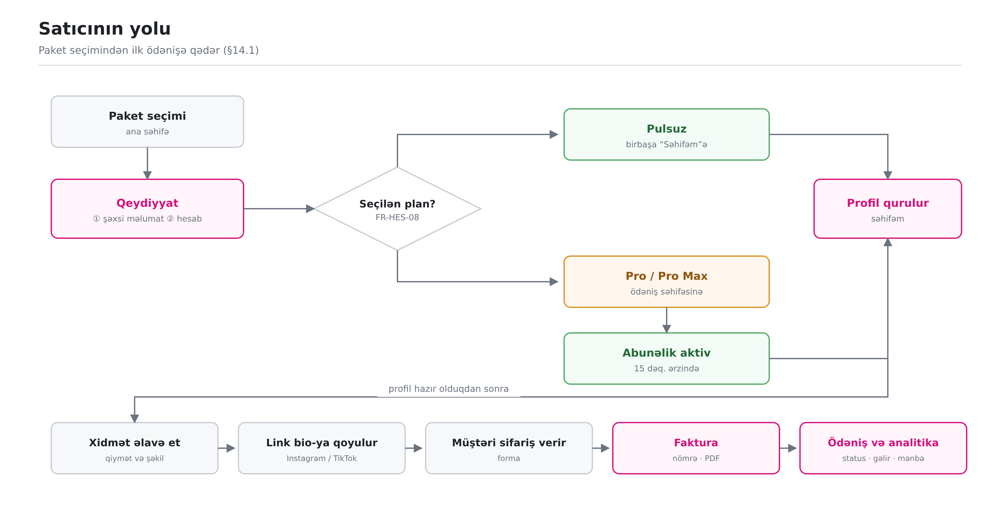

### 14.2 Proses: sifariş axını (qiymət növündən asılı)

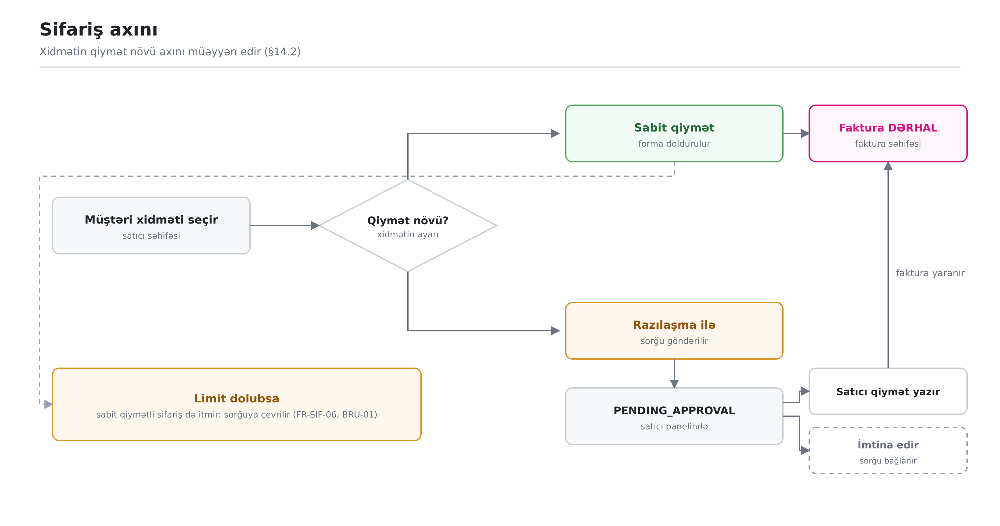

### 14.3 Proses: ödənişin təsdiqi (müştəri fakturası)

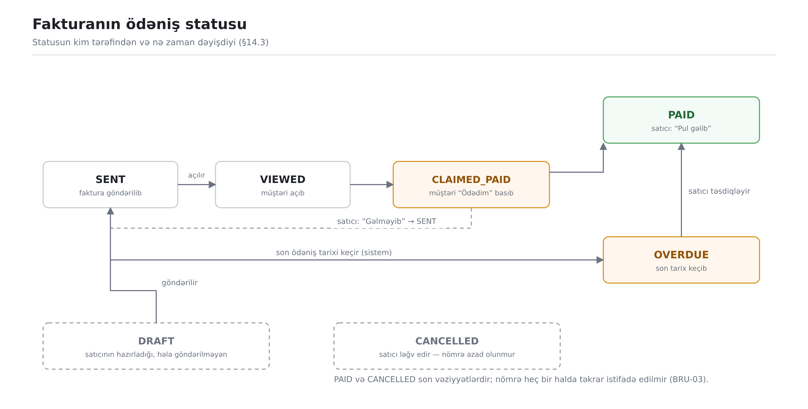

### 14.4 Proses: abunəlik ödənişi

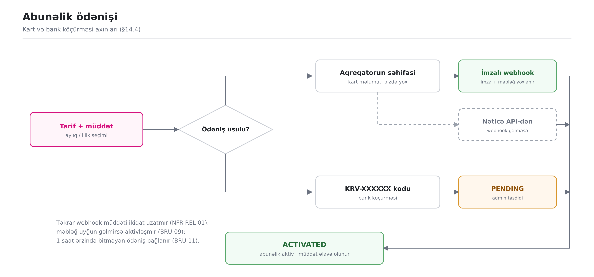

### 14.5 Proses: moderasiya

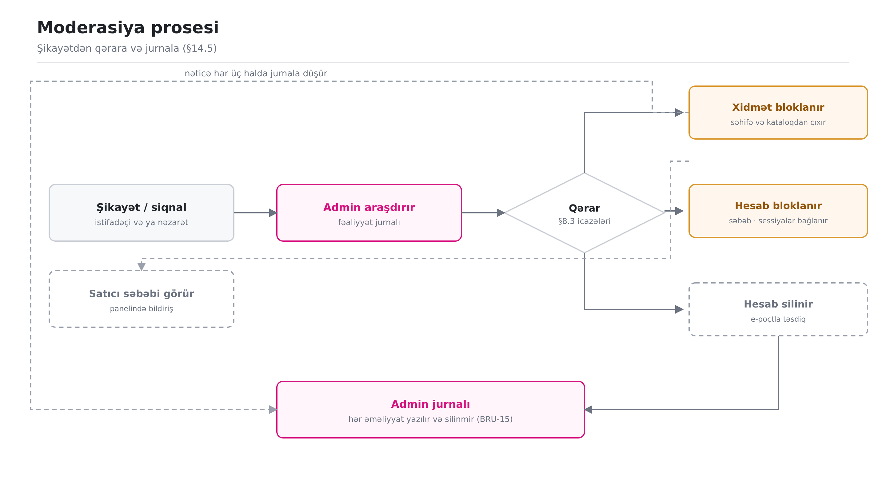

### 14.6 Faktura statusunun keçid matrisi

| Cari ↓ / Hədəf → | DRAFT | SENT | VIEWED | CLAIMED_PAID | PAID | OVERDUE | CANCELLED |
|---|---|---|---|---|---|---|---|
| **DRAFT** | — | ✔ satıcı | — | — | — | — | ✔ satıcı |
| **SENT** | — | — | ✔ müştəri açır | ✔ müştəri | ✔ satıcı | ✔ sistem (son tarix) | ✔ satıcı |
| **VIEWED** | — | — | — | ✔ müştəri | ✔ satıcı | ✔ sistem | ✔ satıcı |
| **CLAIMED_PAID** | — | ✔ satıcı ("gəlməyib") | — | — | ✔ satıcı | — | ✔ satıcı |
| **PAID** | — | — | — | — | — | — | — (son vəziyyət) |
| **OVERDUE** | — | — | — | ✔ müştəri | ✔ satıcı | — | ✔ satıcı |
| **CANCELLED** | — | — | — | — | — | — | — (son vəziyyət) |

`PAID` və `CANCELLED` son vəziyyətlərdir; nömrə heç bir halda azad olunmur (BRU-03).

### 14.7 Əsas istifadə halları

**UC-01 — Müştəri sabit qiymətli xidmət sifariş edir**

| | |
|---|---|
| **Aktor** | Müştəri (qeydiyyatsız) |
| **Ön şərt** | Satıcının aktiv, sabit qiymətli xidməti var; hesab bloklanmayıb |
| **Tetikleyici** | Müştəri "Sifariş et" düyməsini basır |
| **Əsas axın** | 1. Sistem sifariş formasını açır · 2. Müştəri ad və telefonu daxil edir · 3. Sistem sifarişi yaradır və mənbəni qeyd edir · 4. Sistem fakturanı yaradır, nömrə verir · 5. Sistem müştərini faktura səhifəsinə yönləndirir |
| **Alternativ A1** | 4a. Satıcının aylıq faktura limiti dolub → sifariş `PENDING_APPROVAL` sorğusuna çevrilir, müştəriyə satıcının əlaqə saxlayacağı bildirilir (FR-SIF-06) |
| **İstisna E1** | 2a. Telefon formatı yanlış → sahə səviyyəsində xəta göstərilir, sifariş yaradılmır |
| **İstisna E2** | 3a. Xidmət bu arada bloklanıb və ya deaktiv edilib → sifariş qəbul edilmir, səhifə yenilənir |
| **Son nəticə** | Faktura `SENT` statusunda mövcuddur, satıcının panelində görünür |
| **Qəbul** | UAT-01, UAT-02 |

**UC-02 — Satıcı "razılaşma ilə" sorğunu qiymətləndirir**

| | |
|---|---|
| **Aktor** | Satıcı |
| **Ön şərt** | Panelində `PENDING_APPROVAL` statuslu sorğu var |
| **Əsas axın** | 1. Satıcı sorğunu açır · 2. Qiymət və (opsional) qeyd yazır · 3. Təsdiqləyir · 4. Sistem fakturanı yaradır və linki paylaşıma hazırlayır |
| **Alternativ A1** | 3a. Satıcı imtina edir → sorğu bağlanır, müştəriyə faktura yaranmır |
| **İstisna E1** | 4a. Aylıq limit dolub → faktura yaradılmır, satıcıya plan yüksəltmə təklifi göstərilir |
| **Son nəticə** | Faktura mövcuddur və ya sorğu bağlanıb |
| **Qəbul** | UAT-03 |

**UC-03 — Müştəri ödənişi bildirir, satıcı təsdiqləyir**

| | |
|---|---|
| **Aktorlar** | Müştəri, Satıcı |
| **Ön şərt** | Faktura `SENT` və ya `VIEWED` statusundadır |
| **Əsas axın** | 1. Müştəri rekvizitləri kopyalayır və bankda köçürür · 2. "Ödədim" düyməsini basır → `CLAIMED_PAID` · 3. Satıcı bank hesabını yoxlayır · 4. "Pul gəlib" seçir → `PAID` · 5. Məbləğ analitikaya düşür |
| **Alternativ A1** | 4a. "Gəlməyib" seçilir → status `SENT`-ə qayıdır, müştəriyə yenidən bildirmək imkanı qalır |
| **İstisna E1** | Son tarix keçir və ödəniş yoxdur → sistem statusu `OVERDUE` edir |
| **Son nəticə** | Ödənişin vəziyyəti birmənalıdır (BR-04) |
| **Qəbul** | UAT-04, UAT-05 |

**UC-04 — Satıcı Pro Max abunəliyini kartla ödəyir**

| | |
|---|---|
| **Aktor** | Satıcı |
| **Ön şərt** | Aqreqator konfiqurasiya olunub (IR-01) |
| **Əsas axın** | 1. Satıcı tarif və müddət seçir · 2. Sistem aqreqatorda ödəniş yaradır və yönləndirir · 3. Satıcı aqreqatorun səhifəsində ödəyir · 4. Aqreqator imzalı webhook göndərir · 5. Sistem imzanı və məbləği yoxlayır, abunəliyi aktivləşdirir · 6. Satıcıya 15 dəqiqəlik bildiriş göstərilir |
| **Alternativ A1** | 4a. Webhook gəlmir → satıcı qayıdanda nəticə aqreqatorun API-sindən yoxlanılır (FR-ABN-05) |
| **Alternativ A2** | 1a. Satıcı bank köçürməsini seçir → `KRV-XXXXXX` kodu verilir, status `PENDING`, admin təsdiqi gözlənilir |
| **İstisna E1** | 5a. İmza və ya məbləğ uyğun gəlmir → abunəlik aktivləşmir, hadisə jurnala yazılır |
| **İstisna E2** | Ödəniş 1 saat ərzində tamamlanmır → ödəniş bağlanır (BRU-11) |
| **Son nəticə** | Abunəlik `ACTIVATED` və ya əməliyyat uğursuz, iz qalıb |
| **Qəbul** | UAT-06, UAT-07 |

**UC-05 — Admin qaydalara zidd hesabı bloklayır**

| | |
|---|---|
| **Aktor** | Admin |
| **Ön şərt** | Şikayət və ya avtomatik siqnal var |
| **Əsas axın** | 1. Admin istifadəçini axtarır · 2. Fəaliyyət jurnalını oxuyur · 3. Səbəb yazaraq hesabı bloklayır · 4. Sistem sessiyaları bağlayır, səhifəni və xidmətləri gizlədir · 5. Əməliyyat admin jurnalına yazılır |
| **Alternativ A1** | 3a. Yalnız bir xidmət qaydaları pozur → xidmət bloklanır, hesab açıq qalır (FR-ADM-10) |
| **İstisna E1** | Hədəf istifadəçi admindir → əməliyyat qadağandır (BRU-14) |
| **Son nəticə** | Məzmun ictimai görünüşdən çıxıb, iz qalıb |
| **Qəbul** | UAT-08 |

**UC-06 — Ziyarətçi kataloqdan xidmət tapır**

| | |
|---|---|
| **Aktor** | Ziyarətçi |
| **Əsas axın** | 1. Ziyarətçi kataloqu açır · 2. Sahə və şəhər filtrini seçir · 3. Nəticələri sıralayır · 4. Karta klikləyir · 5. Satıcı səhifəsində sifariş verir (UC-01) |
| **Alternativ A1** | 1a. Ziyarətçi axtarış sistemindən sahə səhifəsinə birbaşa düşür (FR-SEO-03) |
| **İstisna E1** | Nəticə yoxdur → filtri yumşaltmaq təklif olunur |
| **Son nəticə** | Mənbə `catalog` kimi qeyd olunur (BG-06) |
| **Qəbul** | UAT-09 |

---

## 15. Biznes qaydaları

BABOK təsnifatı: **D** = definitiv (strukturu müəyyən edir, pozula bilməz) · **B** = davranış qaydası (əməliyyatı məhdudlaşdırır).

| # | Qayda | Növ | Mənbə | Tətbiq yeri | Pozulanda |
|---|---|---|---|---|---|
| BRU-01 | Faktura limiti təqvim ayı üzrə sayılır; `CANCELLED` fakturalar da limitə daxildir | B | Biznes (sui-istifadə) | Faktura yaradılması | Sifariş sorğuya çevrilir |
| BRU-02 | Fərqli valyutalardakı məbləğlər toplanmır, hər valyuta ayrıca göstərilir | D | Mühasibat dəqiqliyi | Analitika, panel | Göstərici gizlədilir |
| BRU-03 | Faktura nömrəsi silinmir və təkrar istifadə olunmur | D | Sənəd bütövlüyü | Nömrələmə | Əməliyyat rədd edilir |
| BRU-04 | Satıcı yalnız öz məlumatına çıxış əldə edir; müştəri telefonu başqa satıcıya görünmür | D | Məxfilik | Bütün sorğular | 404 / icazə yoxdur |
| BRU-05 | FİN və pasport nömrəsi interfeysdə maskalanır (son 3 simvol) və ixraca düşmür | D | Məxfilik | İnterfeys, CSV | Maskalanmış dəyər |
| BRU-06 | Şifrələr geri açılmayan formada saxlanılır; heç bir rol şifrəni görə bilmir | D | Təhlükəsizlik | Autentifikasiya | Funksiya mövcud deyil |
| BRU-07 | Şifrə dəyişdirildikdə və ya admin tərəfindən təyin edildikdə bütün sessiyalar bağlanır | B | Təhlükəsizlik | Şifrə əməliyyatları | Sessiya silinir |
| BRU-08 | Bloklanmış hesabın səhifəsi, xidmətləri və kataloq qeydləri dərhal gizlənir | B | Moderasiya | İctimai səhifələr | 404 |
| BRU-09 | Abunəlik yalnız imza və məbləğ yoxlanışından sonra aktivləşir; uzadılan müddət mövcud müddətin üzərinə əlavə olunur | B | Maliyyə nəzarəti | Webhook emalı | Aktivləşmir, jurnala yazılır |
| BRU-10 | Abunəlik müddəti bitdikdə tarif Pulsuza qayıdır, məlumatlar silinmir | B | Müştəri etibarı | Plan yoxlaması | — |
| BRU-11 | Kart ödənişi 1 saat ərzində tamamlanmasa, "alınmadı" kimi bağlanır | B | Əməliyyat gigiyenası | Ödəniş vəziyyəti | Ödəniş bağlanır |
| BRU-12 | Hesab silinəndə profil, xidmətlər, sifarişlər, fakturalar və şəkillər silinir; jurnal qeydləri saxlanılır | D | Hüquqi / izlənilənlik | Hesab silinməsi | — |
| BRU-13 | AI nəticəsi heç vaxt avtomatik tətbiq olunmur | B | Keyfiyyət nəzarəti | AI funksiyaları | Təsdiq tələb olunur |
| BRU-14 | Admin başqa admini bloklaya və silə bilməz; super admin öz rolunu sonuncu super admin kimi itirə bilməz | B | İdarəetmə davamlılığı | Admin əməliyyatları | Əməliyyat rədd edilir |
| BRU-15 | Hər admin əməliyyatı jurnala yazılır və geri silinmir | D | Hesabatlılıq | Admin paneli | — |
| BRU-17 | Endirim kodu ödənişin məbləğindən böyük ola bilməz; ödəniş sıfıra düşmür | D | Maliyyə nəzarəti | Kuponun tətbiqi | Endirim məhdudlaşdırılır |
| BRU-18 | Kuponun istifadəsi yalnız ödəniş aktivləşəndə sayılır; limit dolubsa qeyd yaradılmır | B | Kampaniya nəzarəti | Aktivləşmə | Sayılmır |
| BRU-19 | İstifadə olunmuş endirim kodu silinmir, yalnız deaktiv edilir | D | Hesabatlılıq | Admin paneli | Əməliyyat rədd edilir |
| BRU-20 | Hesaba hər giriş passivlik sayğacını sıfırlayır; silinmədən əvvəl xəbərdarlıq göndərilir | B | İstifadəçi etibarı | Təmizlənmə | — |
| BRU-21 | Rəy yalnız ödənişi təsdiqlənmiş fakturaya görə yazılır; hər fakturaya bir rəy | D | Saxta rəyin qarşısının alınması | Rəy forması | Forma göstərilmir |
| BRU-22 | Gizlədilmiş rəy satıcının səhifəsində görünmür və orta reytinqə daxil edilmir | B | Moderasiya | Reytinq hesablaması | Reytinq yenidən hesablanır |
| BRU-23 | Bildiriş kanalı qoşulmayıbsa, bildiriş silinmir — "kanal qoşulmayıb" kimi jurnalda qalır | B | İtkinin qarşısının alınması | Bildiriş göndərmə | Status SKIPPED |
| BRU-16 | Pul platformanın hesabında toplanmır | D | Hüquqi model (§23.1) | Ödəniş axını | Dizayn qadağası |

---

## 16. Məlumat tələbləri

### 16.1 Məntiqi məlumat modeli

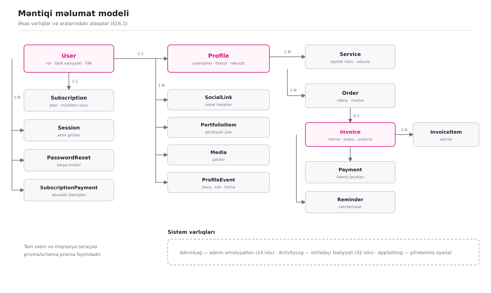

Fiziki sxem: [`prisma/schema.prisma`](../prisma/schema.prisma); miqrasiya tarixçəsi: [`prisma/migrations/`](../prisma/migrations/).

### 16.2 Əsas məlumat tələbləri

| # | Tələb | Pri | Vəz. |
|---|---|---|---|
| DR-01 | Pul məbləğləri ən kiçik vahiddə (qəpik/sent) tam ədəd kimi saxlanılmalıdır | M | ✅ |
| DR-02 | Hər pul sahəsi valyuta kodu ilə birlikdə saxlanılmalıdır | M | ✅ |
| DR-03 | Faktura nömrəsi satıcı üzrə unikal olmalı, paralel yaradılmada təkrarlanmamalıdır | M | ✅ |
| DR-04 | İctimai faktura identifikatoru təsadüfi və təxmin edilə bilməyən olmalıdır (≥ 12 simvol) | M | ✅ |
| DR-05 | Şəxsiyyət sənədi nömrəsi saxlanılmalı, lakin interfeysdə və ixracda maskalanmalıdır | M | ✅ |
| DR-06 | Analitika hadisələri şəxsi identifikator olmadan, anonim ziyarətçi açarı ilə saxlanılmalıdır | M | ✅ |
| DR-07 | Jurnal qeydləri dəyişdirilə və silinə bilməməlidir | M | ✅ |
| DR-08 | Xarici xidmət açarları bazada şifrələnmiş saxlanılmalıdır | M | ✅ |
| DR-09 | Yüklənən şəkillər hazırda bazada saxlanılır; həcm artdıqca obyekt saxlamasına keçid planlaşdırılmalıdır | S | 🟡 §22 RSK-05 |
| DR-10 | Hesab silinəndə əlaqəli məlumat kaskad formada silinməli, jurnal qalmalıdır | M | ✅ |
| DR-11 | İstifadə şərtlərinin qəbulu anı və versiyası hesabla birlikdə saxlanılmalıdır | M | ✅ |
| DR-12 | Son aktivlik tarixi saxlanılmalı və hər girişdə yenilənməlidir | S | ✅ |
| DR-13 | Endirim kodunun istifadəsi ödənişlə bağlı qeyd kimi saxlanılmalıdır (kim, nə vaxt, nə qədər endirim) | S | ✅ |
| DR-14 | Rəy fakturaya bağlı saxlanılmalı, bir fakturaya yalnız bir rəy yazıla bilməlidir | M | ✅ |
| DR-15 | Satıcının orta reytinqi və rəy sayı profildə saxlanılmalı, rəy dəyişəndə yenilənməlidir | S | ✅ |
| DR-16 | Bildirişlər növbə və jurnal kimi saxlanılmalı: hadisə, kanal, status, ünvan və xəta | S | ✅ |

### 16.3 Məlumat lüğəti (seçilmiş sahələr)

| Varlıq | Sahə | Tip | Qayda |
|---|---|---|---|
| Profile | `username` | mətn(3-30) | Unikal, `a-z 0-9 _ .`, qadağan siyahısı (FR-HES-02) |
| Service | `priceType` | enum | `FIXED` / `NEGOTIABLE` |
| Service | `amount` | tam ədəd | Qəpik/sent; `FIXED` üçün məcburi |
| Service | `currency` | enum | `AZN` / `USD` / `EUR` |
| Invoice | `number` | mətn | `<prefiks>-<il>-<sıra>`, satıcı üzrə unikal |
| Invoice | `publicId` | mətn(12) | Təsadüfi, ictimai URL açarı |
| Invoice | `status` | enum | §14.6 keçid matrisi |
| Order | `source` | enum | Mənbə etiketi (FR-ANL-05) |
| SubscriptionPayment | `reference` | mətn | `KRV-XXXXXX` (köçürmə üçün) |
| User | `nationalId` | mətn | FİN(7) / pasport(5-20), maskalanır |
| ActivityLog | `type` | enum | 32 hadisə növü |
| AdminLog | `action` | enum | 14 əməliyyat növü |

### 16.4 Saxlanma və silinmə siyasəti

| Məlumat | Saxlanma müddəti | Əsas |
|---|---|---|
| Hesab və profil | Hesab aktiv olduğu müddətdə | İstifadəçi münasibəti |
| Faktura və sifariş | Hesab silinənə qədər | Satıcının uçot ehtiyacı |
| Müştəri əlaqə məlumatı | Sifarişin ömrü ilə eyni | Minimumlaşdırma (BR-12) |
| Analitika hadisələri | 24 ay (tövsiyə) | Dövr müqayisəsi + məhdudlaşdırma |
| Fəaliyyət və admin jurnalı | 24 ay (tövsiyə), silinmir | Hesabatlılıq (BRU-15) |
| Ödəniş qeydləri | 5 il (tövsiyə) | Maliyyə uçotu |

> ⬜ Saxlanma müddətləri hüquqi rəylə təsdiqlənməlidir (TR-07, §31 S7).

### 16.5 CRUD matrisi (əsas varlıqlar)

`C` yaradır · `R` oxuyur · `U` dəyişir · `D` silir · `—` çıxışı yoxdur

| Varlıq | Ziyarətçi | Müştəri | Satıcı | Admin | Super admin |
|---|---|---|---|---|---|
| Profile | R (ictimai) | R | CRUD (öz) | RU | RUD |
| Service | R (aktiv) | R | CRUD (öz) | RU (moderasiya) | RU |
| Order | — | C | RU (öz) | R | R |
| Invoice | — | R (publicId ilə) | CRUD (öz) | R | R |
| Payment (müştəri) | — | C (iddia) | RU (təsdiq) | R | R |
| SubscriptionPayment | — | — | CR (öz) | RU (təsdiq) | RU |
| ActivityLog | — | — | — | R | R |
| AdminLog | — | — | — | R | R |
| AppSetting | — | — | — | — | RU |

---

## 17. Qeyri-funksional tələblər (NFR)

Təsnifat ISO/IEC 25010 keyfiyyət modelinə uyğundur. Hər NFR ölçülə bilən hədd ilə verilib.

### 17.1 Performans — `NFR-PER`

| # | Tələb | Hədəf | Ölçülmüş | Vəz. |
|---|---|---|---|---|
| NFR-PER-01 | İctimai səhifənin server cavab müddəti | < 2 s | 0,10-0,23 s (produksiya rejimi, lokal) | ✅ |
| NFR-PER-02 | PDF fakturanın yaradılma müddəti | < 3 s | 0,11-0,77 s | ✅ |
| NFR-PER-03 | Kataloq axtarışının cavab müddəti (24 nəticə) | < 2 s | Hədd daxilində | ✅ |
| NFR-PER-04 | Analitika səhifəsinin yüklənməsi (90 günlük dövr) | < 3 s | Hədd daxilində | ✅ |
| NFR-PER-05 | Eyni anda 100 aktiv istifadəçidə deqradasiya olmamalıdır | A/B yük testi | ⬜ Yük testi aparılmayıb | 🟡 |

### 17.2 İstifadə rahatlığı — `NFR-USE`

| # | Tələb | Ölçmə | Vəz. |
|---|---|---|---|
| NFR-USE-01 | Bütün səhifələr mobil ekranda üfüqi sürüşmə olmadan işləməlidir | Cihaz testi | ✅ |
| NFR-USE-02 | Qaranlıq/işıqlı rejim keçidində vizual "parıltı" olmamalıdır | Vizual test | ✅ |
| NFR-USE-03 | Yeni satıcı səhifəni 5 dəqiqəyə qura bilməlidir | Zamanlanmış istifadəçi testi | 🟡 Rəsmi ölçmə aparılmayıb |
| NFR-USE-04 | Xəta mesajları səbəbi və növbəti addımı göstərməlidir | İnspeksiya | ✅ |

### 17.3 Əlçatanlıq — `NFR-ACC`

| # | Tələb | Ölçmə | Vəz. |
|---|---|---|---|
| NFR-ACC-01 | Əsas axınlar yalnız klaviatura ilə keçilə bilməlidir | Manual test | ✅ |
| NFR-ACC-02 | İnteraktiv elementlərdə `aria` etiketləri və kontrast tələbləri gözlənilməlidir | İnspeksiya | ✅ |
| NFR-ACC-03 | `prefers-reduced-motion` seçimi dəstəklənməlidir | İnspeksiya | ✅ |

### 17.4 Təhlükəsizlik — `NFR-SEC`

| # | Tələb | Vəz. |
|---|---|---|
| NFR-SEC-01 | Şifrələr yalnız birtərəfli funksiya (scrypt) ilə saxlanılmalıdır | ✅ |
| NFR-SEC-02 | Sessiya identifikatoru bazada hash formasında saxlanılmalıdır | ✅ |
| NFR-SEC-03 | Ödəniş webhook-ları imza ilə yoxlanılmalı; imzasız callback nəticəsi provayderin API-sindən təsdiqlənməlidir | ✅ |
| NFR-SEC-04 | İctimai faktura identifikatoru təxmin edilə bilməməlidir | ✅ |
| NFR-SEC-05 | Kart məlumatı heç bir halda Karvan serverlərinə daxil olmamalıdır | ✅ |
| NFR-SEC-06 | Admin bölməsinin mövcudluğu icazəsiz istifadəçiyə açıqlanmamalıdır | ✅ |
| NFR-SEC-07 | Yüklənən faylın sahibliyi və tipi yoxlanılmalıdır | ✅ |
| NFR-SEC-08 | İstifadəçi daxil etdiyi linklərdə yalnız `http(s)` və `mailto` sxemlərinə icazə verilməlidir | ✅ |
| NFR-SEC-09 | Xarici xidmət açarları şifrələnmiş saxlanılmalı, interfeysdə yenidən göstərilməməlidir | ✅ |
| NFR-SEC-10 | İctimai formalar və AI endpoint-ləri IP əsaslı sürət məhdudiyyəti ilə qorunmalıdır | ✅ Sifariş, "Ödədim", şəkil yükləmə, analitika, AI, giriş, qeydiyyat və şifrə bərpası üzrə limit (`src/lib/rate-limit.ts`) |

### 17.5 Məxfilik — `NFR-PRV`

| # | Tələb | Vəz. |
|---|---|---|
| NFR-PRV-01 | Analitikada şəxsi identifikasiya məlumatı saxlanılmamalıdır | ✅ |
| NFR-PRV-02 | Şəxsiyyət sənədi nömrələri maskalanmalı və ixracdan kənarda qalmalıdır | ✅ |
| NFR-PRV-03 | Hesab silindikdə şəxsi məlumat silinməlidir | ✅ |
| NFR-PRV-04 | Məlumatların işlənməsi barədə məlumatlandırma dərc olunmalıdır | 🟡 `/mexfilik` və `/cookie` səhifələri hazırdır (layihə variantı); hüquqi təsdiq qalır — TR-07 |

### 17.6 Etibarlılıq və dayanıqlıq — `NFR-REL`

| # | Tələb | Vəz. |
|---|---|---|
| NFR-REL-01 | Təkrar gələn webhook abunəlik müddətini ikiqat uzatmamalıdır (idempotentlik) | ✅ |
| NFR-REL-02 | İtmiş webhook istifadəçi qayıdanda API sorğusu ilə kompensasiya olunmalıdır | ✅ |
| NFR-REL-03 | AI və e-poçt xidmətlərinin xətası əsas biznes əməliyyatını dayandırmamalıdır | ✅ |
| NFR-REL-04 | Verilənlər bazasının gündəlik ehtiyat nüsxəsi götürülməlidir | 🟡 `npm run db:backup` skripti hazırdır; produksiyada cədvəl üzrə işə salınmalıdır (TR-04) |
| NFR-REL-05 | Hədəf işləmə müddəti (uptime) ≥ 99,5% aylıq | 🟡 `/api/health` nöqtəsi hazırdır; xarici monitorinq qoşulmalıdır (TR-06) |

### 17.7 İzlənilənlik və dəstəklənmə — `NFR-OPS`

| # | Tələb | Vəz. |
|---|---|---|
| NFR-OPS-01 | İstifadəçi fəaliyyəti və admin əməliyyatları jurnalda saxlanılmalıdır | ✅ |
| NFR-OPS-02 | Hər əməliyyat üçün vaxt, aktor və (mümkün olduqda) IP qeyd edilməlidir | ✅ |
| NFR-OPS-03 | İş mühiti bir əmrlə qurulmalıdır (baza, miqrasiya, demo məlumat) | ✅ |
| NFR-OPS-04 | Kritik xətalar üçün xəbərdarlıq kanalı olmalıdır | 🟡 `/api/health` 503 qaytarır; xəbərdarlıq kanalı monitorinq xidmətində qurulmalıdır (TR-06) |

### 17.8 Uyğunluq və dəyişdirilə bilənlik — `NFR-POR`

| # | Tələb | Vəz. |
|---|---|---|
| NFR-POR-01 | Ödəniş aqreqatoru konfiqurasiya ilə dəyişdirilə bilməlidir | ✅ |
| NFR-POR-02 | AI təminatçısı yenidən qurulma olmadan dəyişdirilə bilməlidir | ✅ |
| NFR-POR-03 | Yeni dilin əlavəsi kod dəyişikliyi olmadan lüğət faylı ilə mümkün olmalıdır | ✅ |
| NFR-POR-04 | Yeni ölkə kodu və valyuta konfiqurasiya səviyyəsində əlavə edilə bilməlidir | ✅ |

---

## 18. İnterfeys və inteqrasiya tələbləri (IR)

### 18.1 IR-01 — Ödəniş aqreqatoru (abunəlik)

| | |
|---|---|
| **Dəstəklənən** | Epoint (`PAYMENT_GATEWAY=epoint`), Payriff (`payriff`), test rejimi (`sandbox`) |
| **Axın** | Yönləndirmə → aqreqatorun səhifəsi → imzalı webhook → aktivləşmə |
| **Webhook ünvanı** | `https://<domen>/api/payments/webhook/<provider>` |
| **Qoruma** | İmza yoxlanışı, məbləğ uyğunluğu, təkrar bildirişə qarşı atomik "tutma", nəticənin API-dən təsdiqi (Payriff-in callback-i imzasız olduğu üçün nəticə həmişə API-dən soruşulur) |
| **SLA tələbi** | Webhook 5 dəqiqə ərzində; API sorğusu ≤ 5 s |
| **Asılılıq** | Fiziki şəxslə müqavilə imkanı, komissiya və payout şərtləri (§31 S1) |
| **Vəziyyət** | 🟡 Kod hazırdır, real hesab açarları ilə sınaqdan keçirilməyib — RSK-01 |

### 18.2 IR-02 — AI təminatçısı

| | |
|---|---|
| **Təminatçılar** | Groq, Google Gemini, OpenRouter, Ollama (lokal), Anthropic Claude |
| **Konfiqurasiya** | Admin → Parametrlər → AI (bazada şifrələnmiş) və ya mühit dəyişəni |
| **Tələb** | Təminatçı dəyişdirildikdə tətbiq yenidən başladılmamalıdır (FR-AI-07) |
| **Məhdudiyyət** | Pulsuz tariflərdə sorğu limitləri var; bəzi pulsuz tariflərdə göndərilən məlumat modelin təkmilləşdirilməsində istifadə oluna bilər — canlı mühitdə ödənişli tarif və ya lokal model tövsiyə olunur |
| **Vəziyyət** | ✅ |

### 18.3 IR-03 — Bildiriş kanalları

| Kanal | Vəziyyət | Tələb olunan |
|---|---|---|
| E-poçt | Kod hazır (Resend) | API açarı, domen təsdiqi — **lansı bloklayır** (FR-HES-06) |
| SMS | ⬜ Yoxdur | Yerli provayder müqaviləsi |
| WhatsApp | ✅ `wa.me` linki | Avtomatik göndərmə üçün Business API |
| Push | ⬜ Yoxdur | Veb push abunəliyi (v1.1) |

### 18.4 IR-04 — Fayl saxlama

Şəkillər hazırda verilənlər bazasında saxlanılır (`Media`). Satıcı sayı və fayl həcmi artdıqca S3-uyğun obyekt saxlamasına (məs. Cloudflare R2) keçid tələb olunur. 🟡 — DR-09, RSK-05.

### 18.5 IR-05 — Axtarış sistemləri

Sitemap, robots, strukturlu məlumat və Open Graph vasitəsilə birtərəfli inteqrasiya (FR-SEO-05…07). Lansdan sonra Search Console-a əlavə edilməlidir (TR-13).

---

## 19. Keçid tələbləri (TR)

Keçid tələbləri yalnız cari vəziyyətdən hədəf vəziyyətə keçid dövründə qüvvədədir və lansdan sonra bağlanır.

| # | Keçid tələbi | Növ | Məsul | Vəz. |
|---|---|---|---|---|
| TR-01 | Produksiya mühiti qurulmalı və domen yönləndirilməlidir | Mühit | Texniki | ⬜ Addımlar: `docs/BURAXILIS.md` |
| TR-02 | Tətbiq sirləri (`APP_SECRET`, aqreqator açarları, bank rekvizitləri) təhlükəsiz saxlanmalı və yüklənməlidir | Mühit | Texniki | ⬜ |
| TR-03 | Miqrasiyalar produksiya bazasına tətbiq edilməlidir | Məlumat | Texniki | ⬜ |
| TR-04 | Gündəlik ehtiyat nüsxə və bərpa prosedurları qurulmalı, bərpa bir dəfə sınaqdan keçirilməlidir | Əməliyyat | Texniki | 🟡 Skript hazırdır; cədvəl (cron) və bərpa sınağı produksiyada |
| TR-05 | Demo və test məlumatı produksiyadan silinməli və ya gizlədilməlidir (metrikləri təhrif etməməsi üçün) | Məlumat | Texniki | 🟡 Seed produksiyada işləmir (`NODE_ENV=production` qoruması); mövcud demo hesablar lansda yoxlanılmalıdır |
| TR-06 | İşləmə müddəti monitorinqi və xəta xəbərdarlıq kanalı qurulmalıdır | Əməliyyat | Texniki | 🟡 `/api/health` hazırdır; monitorinq xidməti seçilməlidir |
| TR-07 | İstifadə şərtləri, məxfilik siyasəti və cookie bildirişi dərc olunmalıdır | Hüquqi | Hüquq | 🟡 Üç səhifə və sayt üzrə cookie bildirişi hazırdır; hüquqşünas rəyi və "layihə" xəbərdarlığının silinməsi qalır |
| TR-08 | Dəstək prosedurları yazılmalıdır: şikayət, bloklama, şifrə sıfırlama, ödəniş mübahisəsi | Əməliyyat | Dəstək | ✅ `docs/DESTEK.md` |
| TR-09 | Yeni satıcı üçün onboarding axını və nümunə məzmun hazırlanmalıdır | Təlim | Məhsul | 🟡 |
| TR-10 | Dəstək komandası üçün qısa təlim materialı (admin panel, jurnal, ödənişlər) hazırlanmalıdır | Təlim | Dəstək | ✅ `docs/DESTEK.md` |
| TR-11 | Abunəlik gəlirinin mühasibat uçotu qaydası müəyyən edilməlidir | Maliyyə | Biznes | ⬜ |
| TR-12 | Problemin kəmiyyət təsdiqi üçün satıcı sorğusu (n ≥ 50) aparılmalıdır | Təhlil | BA | ⬜ |
| TR-13 | Sayt Search Console-a əlavə olunmalı, `sitemap.xml` göndərilməlidir | Marketinq | Marketinq | ⬜ |
| TR-14 | Super admin hesabı yaradılmalı, bərpa proseduru sənədləşdirilməlidir | Əməliyyat | Super admin | 🟡 Prosedur `docs/BURAXILIS.md` §3-dədir; hesablar produksiyada yaradılmalıdır |

### 19.1 Dəstək xidməti səviyyəsi (ilkin)

| Müraciət növü | Hədəf ilk cavab | Hədəf həll |
|---|---|---|
| Ödəniş təsdiqlənmir (köçürmə) | 4 saat (iş günü) | 1 iş günü |
| Hesaba giriş problemi | 4 saat | 1 iş günü |
| Məzmun şikayəti | 1 iş günü | 2 iş günü |
| Ümumi sual | 1 iş günü | — |

---

## 20. Hesabatlıq tələbləri

| Hesabat | İstifadəçi | Yer | Məzmun | İxrac | Vəz. |
|---|---|---|---|---|---|
| Satış və auditoriya analitikası | Satıcı | `/dashboard/analytics` | FR-ANL-02…06 | CSV (Pro Max) | ✅ |
| Platforma icmalı və MRR | Admin | `/admin` | FR-ADM-01 | — | ✅ |
| İstifadəçi siyahısı | Admin | `/admin/users` | Profil, plan, status | CSV | ✅ |
| Fəaliyyət və admin jurnalı | Admin | `/admin/logs` | 32 + 14 hadisə növü | CSV | ✅ |
| Abunəlik ödənişləri | Admin | `/admin/payments` | Gözləyən, təsdiqlənmiş, gəlir | CSV | ✅ |
| Biznes məqsədlərinin icmalı (§6) | Sponsor | Aylıq hesabat | BG-01…07 | Əl ilə | ⬜ TR-11 |

---

## 21. Fərziyyələr, məhdudiyyətlər və asılılıqlar

### 21.1 Fərziyyələr

Fərziyyə yanlış çıxarsa, göstərilən tələb və ya göstərici yenidən baxılmalıdır.

| # | Fərziyyə | Təsir sahəsi | Təsdiq üsulu | Yanlış olarsa |
|---|---|---|---|---|
| F-01 | Hədəf auditoriya mobil telefondan istifadə edir (≥ 80%) | NFR-USE-01 | Analitika (cihaz bölgüsü) | Masaüstü interfeysinə investisiya |
| F-02 | Azərbaycanda sosial şəbəkədə xidmət satan aktiv şəxslərin sayı 20 000-dən çoxdur | BG-01 | Bazar araşdırması | Hədəf və proqnoz azaldılır |
| F-03 | Satıcı ayda ən azı 5 faktura göndərəcək | FR-ABN plan limitləri | Analitika | Plan limitləri yenidən qiymətləndirilir |
| F-04 | Ödəyənlərin 60%-i Pro, 40%-i Pro Max seçəcək | §5.4 ARPPU | Faktiki ödənişlər | Maliyyə modeli yenilənir |
| F-05 | Ödəyənlərin 20%-i illik ödəyəcək | §5.4 | Faktiki ödənişlər | Pul axını proqnozu dəyişir |
| F-06 | Aqreqator komissiyası ≈ 2,5% + sabit haqq | §5.4 | Müqavilə | Marja dəyişir |
| F-07 | AI xərci ödəyən satıcı başına ≤ 0,30 AZN | §5.4, FR-AI-08 | İstifadə ölçməsi | Limitlər sıxılır (§31 S4) |
| F-08 | Hostinq və saxlama dəyişən xərci ≤ 0,35 AZN | §5.4 | Faktura | S3 keçidi tezləşir |
| F-09 | Aylıq sabit infrastruktur xərci ≈ 120 AZN | §5.5 | Faktura | Zərərsizlik nöqtəsi dəyişir |
| F-10 | Satıcı müştəri ilə ödəniş münasibətinə görə özü cavabdehdir | BR-08, §23.1 | Hüquqi rəy | Model yenidən qurulur |
| F-11 | Bank köçürməsinin əl ilə təsdiqi 15 dəqiqəlik vədi qarşılayır | FR-ABN-07 | Dəstək statistikası | Vəd dəyişdirilir və ya avtomatlaşdırılır |
| F-12 | Pulsuz AI təminatçısının keyfiyyəti "mətndən faktura" üçün kifayətdir | FR-AI-01 | Satıcı rəyi (G-03) | Ödənişli modelə keçid |

### 21.2 Məhdudiyyətlər

| # | Məhdudiyyət | Növ | Təsir |
|---|---|---|---|
| M-01 | Platforma pul saxlamır və köçürmür | Hüquqi / dizayn | Ödəniş təsdiqi manual qalır (FR-ODN-02) |
| M-02 | Faktura rəsmi vergi sənədi deyil | Hüquqi | VÖEN-li müştəri üçün uyğun deyil (§23.2) |
| M-03 | Kart məlumatı heç vaxt toplanmır | Təhlükəsizlik | Abunəlikdə yönləndirmə modeli məcburidir |
| M-04 | Komanda kiçikdir, dəstək 24/7 deyil | Resurs | SLA iş günü ilə məhdudlaşır (§19.1) |
| M-05 | Büdcə pulsuz/aşağı xərcli xarici xidmətləri üstün tutur | Maliyyə | AI keyfiyyət riski (RSK-02) |
| M-06 | Yerli bank API-ləri fiziki şəxsə açıq deyil | Texniki | Ödənişin avtomatik təsdiqi mümkün deyil |
| M-07 | Abunəlik avtomatik yenilənmir | Texniki / hüquqi | Saxlanma riski (RSK-06) |

### 21.3 Asılılıqlar

| # | Asılılıq | Kimdən | Nə vaxta | Bloklayır |
|---|---|---|---|---|
| A-01 | Ödəniş aqreqatoru ilə müqavilə və açarlar | PD-06, Biznes | Lansdan əvvəl | BG-05, UAT-06 |
| A-02 | E-poçt provayderi və domen təsdiqi | PD-08, Texniki | Lansdan əvvəl | FR-HES-06, FR-BLD-02 |
| A-03 | Hüquqi sənədlərin hazırlanması | PD-09 | Lansdan əvvəl | TR-07 |
| A-04 | Produksiya infrastrukturu və ehtiyat nüsxə | Texniki | Lansdan əvvəl | TR-01…04 |
| A-05 | AI təminatçısının açarı | Super admin | Lansdan əvvəl | FR-AI |
| A-06 | Bank rekvizitlərinin təqdim edilməsi | Biznes | Lansdan əvvəl | FR-ABN-02 |

---

## 22. Risk reyestri

**Qiymətləndirmə:** Ehtimal (E) və Təsir (T) 1-5; Bal = E × T. Bal ≥ 12 → yüksək (həftəlik izlənir), 6-11 → orta, ≤ 5 → aşağı.

| # | Risk | Kateqoriya | E | T | Bal | Cavab | Azaldıcı tədbir | Sahib |
|---|---|---|---|---|---|---|---|---|
| RSK-01 | Aqreqator inteqrasiyası real açarlarla gözləniləndən fərqli işləyir | Texniki / xarici | 3 | 5 | **15** | Azalt | Test mühitində tam ödəniş ssenarisi; adapter tək faylda saxlanılıb; sandbox fallback | Texniki |
| RSK-02 | Pulsuz AI modelinin keyfiyyəti aşağıdır, nəticələr səhvdir | Keyfiyyət | 4 | 3 | **12** | Azalt | Məcburi satıcı təsdiqi (BRU-13); təminatçının dəyişdirilə bilməsi; G-03 metriki | Məhsul |
| RSK-03 | Kataloqda saxta və keyfiyyətsiz elanlar | Reputasiya | 3 | 4 | **12** | Azalt | Moderasiya (FR-ADM-10), bloklama, jurnal, G-01 metriki | Dəstək |
| RSK-04 | Avtomatik bildirişlərin olmaması aktivləşməni və ödənilməni aşağı salır | Məhsul | 4 | 3 | **12** | Azalt | v1.1-də e-poçt prioriteti; panelin "gözləyənlər" bölməsi | Məhsul |
| RSK-05 | Şəkillərin bazada saxlanması həcmi və xərci artırır | Texniki | 3 | 3 | 9 | Azalt | S3/R2 keçid planı (IR-04); həcm monitorinqi | Texniki |
| RSK-06 | Abunəlik avtomatik yenilənmədiyi üçün gəlir itir | Maliyyə | 4 | 3 | **12** | Azalt | Xatırlatma e-poçtu (v1.1), avtomatik yenilənmə (v2); BG-07 izlənməsi | Biznes |
| RSK-07 | `APP_SECRET` olmadan və ya səhv konfiqurasiya ilə lansa çıxış | Əməliyyat | 2 | 5 | 10 | Qarşısını al | Buraxılış siyahısında məcburi bənd (G2, §26) | Texniki |
| RSK-08 | İctimai formaların sui-istifadəsi (spam sifariş) | Təhlükəsizlik | 1 | 3 | 3 | Azaldılıb | IP əsaslı sürət limiti tətbiq olunub (NFR-SEC-10) | Texniki |
| RSK-09 | Axtarış sistemlərində indeksləşmə gözləniləndən gec baş verir | Marketinq | 3 | 3 | 9 | Qəbul et / azalt | Search Console (TR-13), kataloq linklərinin daxili şəbəkəsi | Marketinq |
| RSK-10 | Tək super admin hesabının itirilməsi idarəetməni bağlayır | Əməliyyat | 2 | 5 | 10 | Azalt | CLI ilə bərpa proseduru; ən azı 2 super admin (TR-14) | Super admin |
| RSK-11 | Hüquqi sənədlər lansa yetişmir | Uyğunluq | 3 | 4 | **12** | Azalt | TR-07 üzrə erkən başlama; lansın şərti kimi saxlanması | Hüquq |
| RSK-12 | Satıcı məlumat sızması (müştəri telefonları) | Təhlükəsizlik | 2 | 5 | 10 | Azalt | BRU-04 izolyasiyası, jurnal, ixracda maskalama | Texniki |
| RSK-13 | Rəqib eyni həlli yerli bazara tez gətirir | Bazar | 2 | 4 | 8 | İzlə | SEO ilə erkən mövqe (BG-06), kataloq şəbəkə effekti | Biznes |
| RSK-14 | Ödəniş mübahisəsi platformaya qarşı iddiaya çevrilir | Hüquqi | 2 | 4 | 8 | Ötür | İstifadə şərtlərində məsuliyyət bölgüsü (TR-07), §23.1 modeli | Hüquq |

**Yüksək riskli (bal ≥ 12):** RSK-01, RSK-02, RSK-03, RSK-04, RSK-06, RSK-11 — həftəlik izlənməlidir.

---

## 23. Hüquqi və uyğunluq tələbləri

### 23.1 Ödəniş axınının hüquqi modeli

Pul platformanın hesabında toplanmır: müştəri birbaşa satıcının kartına və ya bank hesabına köçürür (BRU-16). Bu model platformanı ödəniş vasitəçisi statusundan və onunla bağlı lisenziya tələblərindən kənarda saxlayır. Abunəlik ödənişi isə platformanın öz xidmətinin satışıdır və lisenziyalı aqreqator vasitəsilə aparılır.

> Müştəri fakturasının onlayn ödənişi (FR-ODN-05) əlavə olunarsa, **hər satıcının aqreqatorda öz merchant hesabını açması** modeli tövsiyə olunur; platforma hesabında toplama modeli hüquqi statusu dəyişir və ayrıca rəy tələb edir (§31 S3).

### 23.2 Sənədin statusu

Faktura **qeyri-rəsmi ödəniş sorğusudur**. PDF-də "Bu sənəd ödəniş sorğusudur, rəsmi vergi sənədi deyil" qeydi göstərilməlidir. VÖEN və e-qaimə dəstəyi v2-dədir (X-04).

### 23.3 Şəxsi məlumatların işlənməsi

| Tələb | Vəziyyət |
|---|---|
| Toplanan məlumatın minimumlaşdırılması | ✅ (BR-12, DR-06) |
| Şəxsiyyət sənədi nömrəsinin maskalanması | ✅ (BRU-05) |
| Satıcının müştəri məlumatını daxil etməsi barədə məlumatlandırma | 🟡 Məxfilik siyasətinin §4 bəndində; hüquqi təsdiq qalır |
| Cookie bildirişi (anonim analitika identifikatoru) | ✅ Sayt üzrə bildiriş + `/cookie` səhifəsi |
| Məlumatın silinməsi hüququ | ✅ (FR-HES-07, BRU-12) |
| Saxlanma müddətlərinin dərci | 🟡 Məxfilik siyasətinin §6 bəndində dərc olunub; hüquqi təsdiq qalır |

### 23.4 Lansdan əvvəl məcburi hüquqi işlər

| # | İş | Məsul | Bloklayır |
|---|---|---|---|
| H-01 | İstifadə şərtləri (məsuliyyət bölgüsü, qadağan olunmuş məzmun, abunəlik şərtləri) | Hüquq | Lans — 🟡 layihə mətni `/qaydalar` ünvanında hazırdır, rəy gözlənilir |
| H-02 | Məxfilik siyasəti (toplanan məlumat, məqsəd, müddət, hüquqlar) | Hüquq | Lans — 🟡 layihə mətni `/mexfilik` ünvanında hazırdır, rəy gözlənilir |
| H-03 | Cookie bildirişi | Hüquq | ✅ `/cookie` + sayt üzrə bildiriş |
| H-04 | Abunəlikdən imtina və geri qaytarma qaydası | Hüquq + Biznes | Lans |

---

## 24. İzlənilənlik matrisi

| Məqsəd | Biznes tələbi | Paydaş tələbi | Həll tələbi | Qəbul |
|---|---|---|---|---|
| BG-01 Satıcı bazası | BR-01 | SH-SAT-01, SH-SAT-02 | FR-HES-01…03, FR-SEH-01…06 | UAT-01 |
| BG-02 Aktivləşmə | BR-02, BR-03 | SH-SAT-03, SH-SAT-04 | FR-XID-*, FR-SIF-*, FR-FAK-* | UAT-01, UAT-02, UAT-03 |
| BG-03 Dəyər (ödənilmə) | BR-04 | SH-SAT-06, SH-MUS-04 | FR-ODN-01…03, FR-ANL-02 | UAT-04, UAT-05 |
| BG-04 Ödəniş sürəti | BR-04 | SH-MUS-03 | FR-FAK-03, FR-FAK-07, FR-ODN-01 | UAT-04 |
| BG-05 Monetizasiya | BR-07 | SH-SAT-12, SH-ADM-04 | FR-ABN-01…12, FR-HES-08 | UAT-06, UAT-07 |
| BG-06 Orqanik böyümə | BR-06 | SH-SAT-11, SH-MUS-02 | FR-KAT-*, FR-SEO-*, FR-ANL-05 | UAT-09, UAT-10 |
| BG-07 Saxlanma | BR-07 | SH-SAT-12 | FR-ABN-08…10, FR-ADM-11 | UAT-07 |
| — Etibar / nəzarət | BR-09, BR-10 | SH-ADM-02, SH-ADM-03, SH-ADM-06 | FR-ADM-*, BRU-15 | UAT-08, UAT-11 |
| — Hüquqi model | BR-08 | SH-BIZ-03 | FR-ODN-04, FR-ABN-03, BRU-16 | UAT-12 |
| — Məxfilik | BR-12 | SH-MUS-05, SH-ADM-05 | DR-05, DR-06, NFR-PRV-*, BRU-04…06 | UAT-13 |
| — Regional hazırlıq | BR-11 | SH-SAT-09 | FR-DIL-*, FR-HES-03, FR-XID-01 | UAT-14 |

### 24.2 Örtülməyən sahələr (gap)

| Sahə | Vəziyyət | Hərəkət |
|---|---|---|
| SH-MUS-04 (ödənişin onlayn edilməsi) | Qismən — yalnız bildirim | v1.2 (FR-ODN-05) |
| SH-SAT-06 (anlıq xəbərdarlıq) | Qismən — panelə baxmaq lazımdır | v1.1 (FR-BLD-03) |
| SH-SAT-09 (çoxdilli müştəri təcrübəsi) | Qismən — satıcı səhifəsi AZ | v1.3+ (FR-DIL-06) |
| NFR-SEC-10 (IP limiti) | Örtülməyib | Lansdan əvvəl (RSK-08) |
| NFR-REL-04/05 (ehtiyat nüsxə, monitorinq) | Örtülməyib | TR-04, TR-06 |

---

## 25. Qəbul meyarları və UAT planı

### 25.1 Qəbul ssenariləri

| # | Ssenari (Given / When / Then) | Bağlı tələb | Vəz. |
|---|---|---|---|
| UAT-01 | **Given** yeni satıcı qeydiyyatdan keçib və 1 sabit qiymətli xidmət əlavə edib, **when** müştəri sifariş verir, **then** faktura avtomatik yaranır, unikal nömrə alır və PDF açılır | FR-SIF-03, FR-FAK-01 | ✅ |
| UAT-02 | **Given** pulsuz planda 5 faktura var, **when** 6-cı sifariş gəlir, **then** limit mesajı göstərilir və sifariş sorğuya çevrilir (itmir) | FR-SIF-06, BRU-01 | ✅ |
| UAT-03 | **Given** "razılaşma ilə" sorğu var, **when** satıcı qiymət yazıb təsdiqləyir, **then** faktura yaranır; **when** imtina edir, **then** sorğu bağlanır | FR-SIF-04, FR-SIF-05 | ✅ |
| UAT-04 | **Given** faktura `SENT`, **when** müştəri "Ödədim" basır və satıcı təsdiqləyir, **then** status `PAID` olur və məbləğ analitikada gəlirə düşür | FR-ODN-02, FR-ANL-02 | ✅ |
| UAT-05 | **Given** faktura `CLAIMED_PAID`, **when** satıcı "Gəlməyib" seçir, **then** status `SENT`-ə qayıdır və müştəri yenidən bildirə bilir | §14.6 | ✅ |
| UAT-06 | **Given** Pro Max seçilib, **when** kartla ödəniş tamamlanır, **then** webhook-dan sonra tarif aktivləşir və təsdiqlənmiş nişanı görünür | FR-ABN-04, FR-SEH-09 | 🟡 Sandbox-da ✅, real aqreqatorda ⬜ |
| UAT-07 | **Given** eyni webhook iki dəfə gəlir, **then** abunəlik müddəti yalnız bir dəfə uzanır | NFR-REL-01, BRU-09 | ✅ |
| UAT-08 | **Given** admin hesabı bloklayır, **then** hesab sistemdən çıxır, səhifəsi 404 qaytarır, xidmətləri kataloqdan çıxır və əməliyyat jurnala yazılır | FR-ADM-07, BRU-08 | ✅ |
| UAT-09 | **Given** kataloqda sahə filtri seçilib, **then** H1 həmin sahəni göstərir, səhifə indeksləşir və hreflang 4 dildədir | FR-KAT-04, FR-SEO-03 | ✅ |
| UAT-10 | **Given** satıcı etiketli link paylaşıb (`?s=ig`), **when** sifariş gəlir, **then** mənbə analitikada Instagram kimi görünür | FR-ANL-05, FR-ANL-08 | ✅ |
| UAT-11 | **Given** super admin istifadəçi kimi daxil olur, **then** görünən xəbərdarlıq zolağı çıxır, əməliyyat jurnala yazılır və qayıdış işləyir | FR-ADM-14 | ✅ |
| UAT-12 | **Given** abunəlik ödənişi aparılır, **then** kart məlumatı Karvan formalarında toplanmır və istifadəçi aqreqatora yönləndirilir | FR-ABN-03, NFR-SEC-05 | ✅ |
| UAT-13 | **Given** admin istifadəçi siyahısını ixrac edir, **then** faylda FİN/pasport nömrələri yoxdur | FR-ADM-13, BRU-05 | ✅ |
| UAT-14 | **Given** ziyarətçi dili dəyişir, **then** ünvan prefiksi, məzmun və hreflang uyğunlaşır, seçim yadda qalır | FR-DIL-02, FR-DIL-03 | ✅ |
| UAT-15 | **Given** ödənişli planda satıcı səhifəsi açılır, **then** platforma qeydi göstərilmir | FR-SEH-08 | ✅ |
| UAT-16 | **Given** Pro abunəliyinin müddəti bitib, **when** satıcı daxil olur, **then** tarif Pulsuza qayıdır və məlumatları yerindədir | FR-ABN-09, BRU-10 | ✅ |

### 25.2 UAT-ın aparılması

| Element | Qayda |
|---|---|
| Mühit | Produksiyaya bərabər konfiqurasiya; aqreqator test rejimində, sonra bir real ödəniş |
| İştirakçılar | BA (aparıcı), dəstək operatoru, 2-3 real satıcı (PR-01, PR-02 profillərinə uyğun) |
| Giriş şərti | Bütün `M` prioritetli tələblər ✅; §26-nın texniki bəndləri bağlı |
| Çıxış şərti | UAT-01…16-nın hamısı keçir; açıq kritik defekt yoxdur; orta/aşağı defektlər qeydə alınıb və prioritetləşdirilib |
| Defekt siniflənməsi | **Kritik** — biznes axını dayanır / məlumat itir · **Yüksək** — əsas funksiya məhduddur · **Orta** — həll yolu var · **Aşağı** — kosmetik |
| Nəticənin qeydi | Hər ssenari üçün keçdi/keçmədi, tarix, icraçı, defekt nömrəsi |

---

## 26. Buraxılış şərtləri (go / no-go)

| # | Şərt | Növ | Məsul | Vəz. |
|---|---|---|---|---|
| G-01 | Tətbiq ünvanı real domenə yönləndirilib | Texniki | Texniki | ⬜ |
| G-02 | `APP_SECRET` təyin edilib (uzun təsadüfi dəyər) | Texniki | Texniki | ⬜ |
| G-03 | Ödəniş aqreqatoru seçilib, açarlar yazılıb, webhook ünvanı kabinetdə göstərilib və bir real ödəniş uğurla keçib | Biznes + Texniki | Biznes | ⬜ |
| G-04 | Bank rekvizitləri (IBAN, VÖEN, bank adı) konfiqurasiya edilib | Biznes | Biznes | ⬜ |
| G-05 | AI açarı admin paneldə yazılıb və yoxlama sorğusu uğurlu cavab verib | Texniki | Super admin | ⬜ |
| G-06 | E-poçt provayderi qoşulub (şifrə bərpası üçün minimum) | Texniki | Texniki | ⬜ |
| G-07 | İstifadə şərtləri, məxfilik siyasəti və cookie bildirişi dərc olunub | Hüquqi | Hüquq | 🟡 Mətnlər hazırdır, hüquqi təsdiq gözlənilir |
| G-08 | Super admin hesabı yaradılıb (ən azı 2), demo hesablar silinib | Əməliyyat | Super admin | ⬜ |
| G-09 | Gündəlik ehtiyat nüsxə işləyir və bərpa bir dəfə sınaqdan keçirilib | Əməliyyat | Texniki | 🟡 Skript hazırdır (`npm run db:backup`), cədvəl və bərpa sınağı qalır |
| G-10 | İşləmə müddəti monitorinqi və xəta xəbərdarlığı aktivdir | Əməliyyat | Texniki | 🟡 `/api/health` hazırdır, xarici xidmətə qoşulmalıdır |
| G-11 | İctimai formalar üçün IP əsaslı sürət limiti tətbiq olunub | Təhlükəsizlik | Texniki | ✅ |
| G-12 | UAT-01…16 keçib, açıq kritik defekt yoxdur | Keyfiyyət | BA | ⬜ |
| G-13 | Sayt Search Console-a əlavə olunub, `sitemap.xml` göndərilib | Marketinq | Marketinq | ⬜ |
| G-14 | Dəstək prosedurları yazılıb və komanda təlim keçib | Əməliyyat | Dəstək | 🟡 Prosedurlar yazılıb (`docs/DESTEK.md`), təlim qalır |

**Qərar qaydası:** G-01…G-12 **məcburidir** (hamısı bağlanmalıdır). G-13 və G-14 lansdan sonrakı ilk həftədə bağlana bilər. Bir və ya bir neçə məcburi şərt açıqdırsa, qərar **no-go** olur.

### 26.1 Geri qayıtma (rollback) planı

| Ssenari | Hərəkət | Məsul |
|---|---|---|
| Ödəniş axını işləmir | Kart ödənişi müvəqqəti söndürülür, yalnız bank köçürməsi qalır (FR-ABN-02); istifadəçilərə bildirilir | Texniki |
| Kritik məlumat defekti | Tətbiq "yalnız oxu" rejimində saxlanılır, son ehtiyat nüsxədən bərpa olunur (TR-04) | Texniki |
| Yeni buraxılış regresiya yaradır | Əvvəlki versiyaya qayıdılır; miqrasiya geri qaytarılmırsa, düzəliş irəli buraxılışla verilir | Texniki |
| Kütləvi spam / sui-istifadə | Qeydiyyat müvəqqəti dəvətlə məhdudlaşdırılır, moderasiya gücləndirilir | Dəstək |

---

## 27. Həllin qiymətləndirilməsi (solution evaluation)

### 27.1 Ölçmə dövrləri

| Dövr | Nə ölçülür | Qərar nöqtəsi |
|---|---|---|
| Lans + 7 gün | Texniki sabitlik, kritik defekt, qeydiyyat axını | Lansı genişləndirmək / saxlamaq |
| Lans + 30 gün | BG-01, BG-02, G-01…G-04 əks-metrikləri | Məhsul prioritetlərinin yenilənməsi |
| Lans + 90 gün | BG-01…BG-06, maliyyə modelinin faktiki ilə müqayisəsi | v1.1/v1.2 əhatəsinin təsdiqi |
| Lans + 180 gün | BG-06, BG-07, LTV/CAC | Qiymət strukturunun yenidən baxılması |

### 27.2 Faydaların realizasiyası

| Fayda | Ölçmə | Baza | 90 gün hədəfi | Məsul |
|---|---|---|---|---|
| F3 Ödənilmə nisbəti | Analitika aqreqatı | — | ≥ 70% | Məhsul |
| F4 Ödəniş müddəti | Analitika | — | < 24 saat | Məhsul |
| F5 Kataloq axını | Mənbə bölgüsü | 0 | ≥ 15% (180 gün) | Marketinq |
| F6 Abunəlik gəliri | MRR | 0 | ≥ 435 AZN | Biznes |
| F1, F2, F7 | Satıcı sorğusu (n ≥ 30) | — | Müsbət tendensiya | BA |

### 27.3 Modelin yenilənməsi

§5-dəki maliyyə modeli hər rüb faktiki göstəricilərlə yenilənir. Fərziyyə ilə faktiki arasında ≥ 30% fərq yaranarsa, §5.6 proqnozu və §6 hədəfləri yenidən baseline edilir (§28).

---

## 28. Tələblərin idarə olunması və dəyişiklik nəzarəti

### 28.1 Baseline

Versiya 2.0 təsdiqləndikdən sonra (§0.4) bu sənəd **baseline** sayılır. Baseline-dakı hər dəyişiklik dəyişiklik sorğusundan (CR) keçir.

### 28.2 Dəyişiklik prosesi

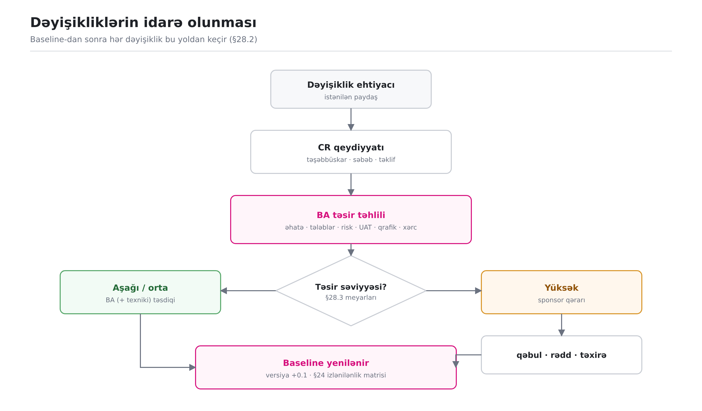

### 28.3 Təsirin təsnifatı

| Səviyyə | Meyar | Qərar verən |
|---|---|---|
| Aşağı | Yalnız ifadə dəqiqləşir, həll dəyişmir | BA |
| Orta | Bir həll tələbi əlavə olunur/dəyişir, qrafikə təsiri yoxdur | BA + Texniki |
| Yüksək | Əhatə, qiymət strukturu, hüquqi model və ya BG hədəfi dəyişir | Sponsor |

---

## 29. Yol xəritəsi

| Mərhələ | Məzmun | Biznes əsası | Bağladığı boşluq |
|---|---|---|---|
| **v1.0 — Lans** | Mövcud əhatə (§7.2) | BG-01…BG-04 | — |
| **v1.1 — Bildirişlər** | E-poçt provayderi, yeni sifariş və ödəniş bildirişləri, avtomatik xatırlatmalar | Ödənilmə nisbətini artırır (BG-03), reaksiyanı sürətləndirir | X-02, RSK-04 |
| **v1.2 — Müştəri ödənişi** | Fakturanın kartla onlayn ödənişi (satıcı öz merchant hesabı ilə) | Ödəniş sürəti (BG-04), Pro plana keçid motivi (BG-05) | X-01, İ-11 |
| **v1.3 — Kataloqun gücləndirilməsi** | Sahə/şəhər ünvanlarının genişlənməsi, faktura səhifəsi və panelin qalan bölmələrinin çoxdilliliyi | Orqanik trafik (BG-06) | FR-DIL-06 |
| **v1.4 — Komanda** | Pro Max-da 5 üzv, rol bölgüsü | Studiyalar üçün Pro Max dəyəri | X-03 |
| **v2 — Rəsmiləşmə və avtomatlaşdırma** | VÖEN/e-qaimə, abunəliyin avtomatik yenilənməsi, obyekt saxlamasına keçid | Böyük satıcılar, saxlanma (BG-07) | X-04, X-09, RSK-05, RSK-06 |

---

## 30. Məlum məhdudiyyətlər

| # | Məhdudiyyət | Təsir | Həll yolu | Mərhələ |
|---|---|---|---|---|
| 30.1 | ~~Tarif dəyişdirildikdə qalan müddət itir~~ — həll olunub (FR-ABN-11) | — | Qalan müddət yeni tarifdə gün kimi əlavə olunur | ✅ |
| 30.2 | Faktura səhifəsi, panelin ikinci dərəcəli bölmələri (fakturalar, səhifəm, abunəlik, parametrlər) və admin panel Azərbaycan dilindədir (FR-DIL-06) | Xarici satıcı bu ekranlarda Azərbaycan dili görür | Lüğətin həmin bölmələrə genişləndirilməsi | v1.3 |
| 30.3 | Avtomatik bildiriş yoxdur (FR-BLD-03) | Satıcı yeni sifarişi panelə girəndə görür | E-poçt provayderi | v1.1 |
| 30.4 | Fəaliyyət jurnalı yalnız bu versiyadan sonrakı hadisələri saxlayır | Tarixi araşdırma məhduddur | — | Qəbul edilib |
| 30.5 | Pulsuz AI modellərinin dil keyfiyyəti aşağıdır (RSK-02) | "Mətndən faktura" nəticələri düzəliş tələb edir | Ödənişli tarif və ya lokal model | Konfiqurasiya |
| 30.6 | Şəkillər bazada saxlanılır (DR-09) | Həcm və performans riski | Obyekt saxlamasına keçid | v2 |
| 30.7 | ~~IP əsaslı sürət limiti yoxdur~~ — həll olunub (NFR-SEC-10) | — | Limitlər `src/lib/rate-limit.ts` faylında bir yerdə ayarlanır | ✅ |
| 30.8 | Yük testi aparılmayıb (NFR-PER-05) | 100+ eyni vaxtlı istifadəçidə davranış naməlumdur | Lansdan sonra yük testi | Lans + 30 gün |
| 30.9 | ~~Abunəlik ödənişləri hesabatının ixracı yoxdur~~ — həll olunub (§20) | — | Admin → Ödənişlər səhifəsində CSV ixracı | ✅ |

---

## 31. Açıq suallar və qərar jurnalı

### 31.1 Açıq suallar

| # | Sual | Niyə vacibdir | Qərar verən | Son tarix |
|---|---|---|---|---|
| S1 | Hansı aqreqator seçilir: Epoint, yoxsa Payriff (komissiya, payout müddəti, fiziki şəxslə müqavilə)? | G-03 və §5.4 marjası bundan asılıdır | Biznes | Lansdan əvvəl |
| S2 | `*0221` nömrəsi və `hello@karvan.az` ünvanı real əlaqə kanallarıdırmı? | Dəstək SLA və hüquqi sənədlər | Biznes | Lansdan əvvəl |
| S3 | Müştəri fakturasının onlayn ödənişində model: hər satıcının öz merchant hesabı, yoxsa platforma hesabı? | §23.1 hüquqi statusu dəyişir | Biznes + Hüquq | v1.2-dən əvvəl |
| S4 | Pulsuz planda AI limiti saxlanılsın, yoxsa azaldılsın (xərc nəzarəti)? | F-07 fərziyyəsi və marja | Biznes | Lans + 30 gün |
| ~~S5~~ | Rəy sistemi açıldı: yalnız ödənilmiş faktura sahibi yaza bilir, admin gizlədə bilir | Qərar verilib | Məhsul | ✅ |
| S6 | Problemin kəmiyyət təsdiqi üçün sorğu nə vaxt aparılır (TR-12)? | §2.2 dəyər fərziyyələri | BA + Məhsul | Lansdan əvvəl |
| S7 | Məlumatların saxlanma müddətləri (§16.4) hüquqi rəylə təsdiqlənirmi? | TR-07, NFR-PRV-04 | Hüquq | Lansdan əvvəl |
| S8 | Abunəlikdən imtina və geri qaytarma qaydası necə olacaq? | H-04, müştəri etibarı | Biznes + Hüquq | Lansdan əvvəl |

### 31.2 Qəbul edilmiş qərarlar

| # | Qərar | Əsas | Tarix |
|---|---|---|---|
| Q-01 | Pul platformada toplanmır (BRU-16) | Lisenziya tələbindən qaçmaq (§23.1) | v1.0 |
| Q-02 | Freemium abunəlik, satışdan komissiya yoxdur | Satıcı üçün aydın dəyər, hüquqi sadəlik | v1.0 |
| Q-03 | Planlar: Pulsuz / Pro 9,99 / Pro Max 29,99 AZN | Bazar üçün əlçatan qiymət | v1.0 |
| Q-04 | Kart məlumatı toplanmır, yönləndirmə modeli | NFR-SEC-05 | v1.0 |
| Q-05 | AI təminatçısı dəyişdirilə bilən saxlanılır | Asılılıq riski (SH-BIZ-04) | v1.0 |
| Q-06 | Abunəlik avtomatik yenilənmir | Hüquqi sadəlik və istifadəçi etibarı | v1.0 |
| Q-07 | Kataloqda iştirak defolt olaraq açıqdır, satıcı söndürə bilir | BG-06 və SH-SAT-11 balansı | v1.0 |

---

## 32. Lüğət və əlavələr

### 32.1 Lüğət

| Termin | İzah |
|---|---|
| **Satıcı** | Karvan-da hesabı olan, xidmət satan şəxs |
| **Səhifə ünvanı** | `karvan.az/<username>` — satıcının ictimai səhifəsi |
| **Razılaşma ilə** | Qiyməti əvvəlcədən müəyyən olmayan xidmət; satıcı sorğunu təsdiqləyəndə qiymət yazılır |
| **Ödəniş kodu** | `KRV-XXXXXX` — bank köçürməsinin təyinat sahəsinə yazılan unikal kod |
| **Webhook** | Ödəniş sisteminin nəticəni serverə göndərdiyi imzalı bildiriş |
| **Aqreqator** | Kart ödənişlərini qəbul edən lisenziyalı vasitəçi (Epoint, Payriff) |
| **İdempotentlik** | Eyni əməliyyatın təkrar icrasının nəticəni dəyişməməsi |
| **MRR** | Aylıq təkrarlanan gəlir |
| **ARPPU** | Ödəyən istifadəçi başına orta gəlir |
| **LTV / CAC** | Müştərinin ömürlük dəyəri / cəlb xərci |
| **MoSCoW** | Prioritet metodu: Must, Should, Could, Won't |
| **RACI** | Məsuliyyət matrisi: Responsible, Accountable, Consulted, Informed |
| **Uzun-quyruq axtarış** | "makiyaj ustası Bakı" kimi dar, niyyəti aydın sorğular |
| **Canonical** | Təkrar ünvanlar arasında axtarış sisteminə göstərilən əsas ünvan |
| **UAT** | İstifadəçi qəbul testi |
| **Baseline** | Təsdiqlənmiş və dəyişiklik nəzarətinə düşən tələblər toplusu |

### 32.2 Əlavə A — Tələblərin xülasəsi

| Tələb növü | Sayı | ✅ | 🟡 | ⬜ |
|---|---|---|---|---|
| Biznes tələbləri (BR) | 12 | — | — | — |
| Paydaş tələbləri (SH) | 29 | — | — | — |
| Funksional tələblər (FR) | 143 | 135 | 5 | 3 |
| Qeyri-funksional tələblər (NFR) | 35 | 29 | 5 | 1 |
| Məlumat tələbləri (DR) | 16 | 15 | 1 | 0 |
| İnterfeys tələbləri (IR) | 5 | 2 | 2 | 1 |
| Keçid tələbləri (TR) | 14 | 0 | 1 | 13 |
| Biznes qaydaları (BRU) | 23 | 23 | — | — |
| **Cəmi həll tələbi** | **206** | **187** | **14** | **4** |

### 32.3 Əlavə B — Buraxılış hazırlığının xülasəsi

| Kateqoriya | Hazır | Açıq | Bloklayır? |
|---|---|---|---|
| Funksional əhatə | 91% | FR-ODN-05, FR-BLD-03/04, FR-KAT-09 | Xeyr (hamısı `W`/`S`) |
| Təhlükəsizlik | 10/10 | — | Xeyr |
| Etibarlılıq | 3/5 (+2 qismən) | NFR-REL-04, NFR-REL-05 — produksiyada qoşulmalıdır | Qismən — G-09, G-10 |
| Hüquqi | 2/6 | H-01…H-04 | **Bəli** — G-07 |
| İnteqrasiya | 2/5 | IR-01 real sınaq, IR-03 e-poçt | **Bəli** — G-03, G-06 |
| Keçid (TR) | 0/14 | Hamısı | **Bəli** |

### 32.4 Əlavə C — v1.0 → v2.0 tələb nömrələrinin uyğunluğu

| v1.0 | v2.0 | | v1.0 | v2.0 |
|---|---|---|---|---|
| BR-A-xx | FR-HES-xx | | BR-AI-xx | FR-AI-xx |
| BR-P-xx | FR-SEH-xx | | BR-AB-xx | FR-ABN-xx |
| BR-S-xx | FR-XID-xx | | BR-AD-xx | FR-ADM-xx |
| BR-K-xx | FR-KAT-xx | | BR-L-xx | FR-DIL-xx |
| BR-O-xx | FR-SIF-xx | | BR-SEO-xx | FR-SEO-xx |
| BR-F-xx | FR-FAK-xx | | BR-N-xx | FR-BLD-xx |
| BR-Ö-xx | FR-ODN-xx | | BQ-xx | BRU-xx |
| BR-AN-xx | FR-ANL-xx | | QM-xx | UAT-xx |

v1.0-dakı §3 metrikləri (M1…M7) v2.0-da BG-01…BG-07 kimi, §16 riskləri (R1…R8) isə RSK-01…RSK-14 daxilində verilib.

---

